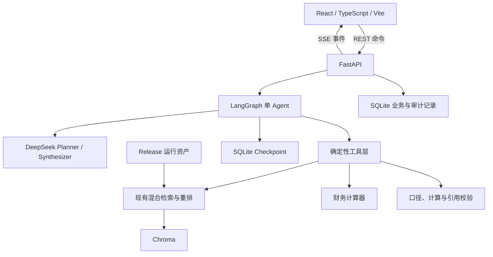
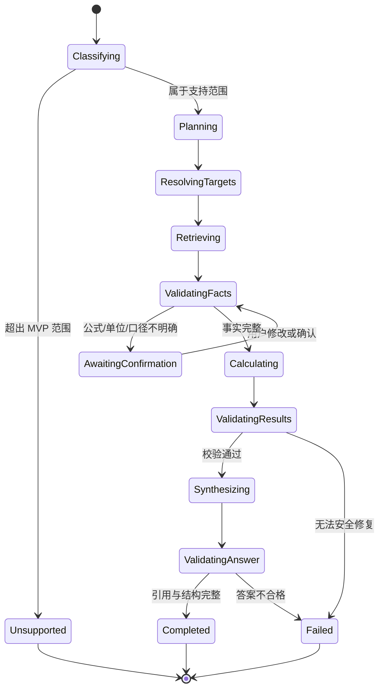
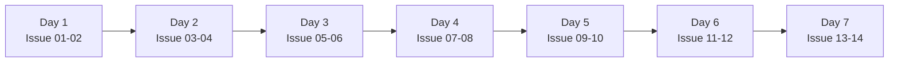

# 财报分析 Agent 迭代方案

> 状态：已确认，待实施  
> 制定日期：2026-09-13  
> 目标：在开始投递前的一周内，将现有单轮财报 RAG 升级为可公开访问、可演示、可继续迭代的 Agent MVP。  
> 使用方式：本文是个人开发执行清单。每个任务均控制在一天以内，后续可由 Codex 据此创建 Issue。

## 1. 已确认的目标

第一版 Agent 应当能够：

1. 理解复杂财报研究问题；
2. 自动拆解任务并生成可展示的执行计划；
3. 调用现有检索、指标抽取、计算和校验能力；
4. 在公式、单位或财务口径不明确时暂停并请求用户确认；
5. 在确认后从原任务继续执行；
6. 输出分析结论、数据表、公式、中间结果、限制和逐项引用；
7. 支持当前会话中的追问和范围调整；
8. 通过 Docker 部署为可匿名访问的免费公网 Demo。

### 1.1 MVP 正式支持的任务

- 跨年度趋势分析；
- 跨公司指标比较；
- 财务比率计算与解释。

### 1.2 数据范围

- 比亚迪、宁德时代、贵州茅台、美的集团、中国移动；
- 2023—2025 年；
- 当前 Manifest 中已经标记为 `retrieval_quality_accepted` 的 15 份年报；
- 暂不支持用户上传 PDF；
- 暂不接入年报之外的市场、新闻、行情或宏观数据。

### 1.3 第一版不承诺的能力

- 任意指标的自由计算；
- 开放式变化原因归因；
- 三张报表自动勾稽；
- 风险综合分析；
- 观点支持/反驳；
- 完整研究报告；
- 投资建议、估值、目标价、选股或股价预测；
- 多 Agent 协作；
- 跨设备长期记忆；
- 企业级高可用和永久数据保存。

对于暂不支持的任务，Agent 可以识别用户意图，但必须明确说明能力边界，不得以不可靠的自由推理代替正式支持。

## 2. 当前项目基线

应优先复用以下经过现有测试和评测约束的能力：

| 能力 | 当前实现 |
| --- | --- |
| PDF 登记 | `src/ingestion/register_report.py` |
| 页面解析 | `src/parsing/parse_report.py` |
| 页面审计 | `src/parsing/audit_pages.py` |
| 固定长度切块 | `src/chunking/baseline_chunker.py` |
| 结构化切块 | `src/chunking/structured_chunker.py` |
| Chroma 建库 | `src/indexing/build_index.py` |
| BGE 向量检索 | `src/retrieval/search.py` |
| 中文 BM25 | `src/retrieval/bm25.py` |
| RRF 与财务规则重排 | `src/retrieval/hybrid.py` |
| 单报告 RAG | `src/generation/rag.py` |
| DeepSeek 适配 | `src/generation/deepseek.py` |
| 受控跨公司比较 | `src/generation/comparison.py` |
| 检索与 RAG 评测 | `src/evaluation/` |
| 旧版界面 | `app/streamlit_app.py` |

现有 Streamlit 应用作为 `legacy demo` 保留。新版不得通过大规模重写破坏原有 RAG 链，应通过工具适配层复用它。

### 2.1 实施前必须处理的已知风险

1. 当前 Windows checkout 使用 `core.autocrlf=true`，冻结题 CSV 的工作区字节哈希与 freeze JSON 不一致；必须先明确哈希规范并恢复跨平台测试可靠性。
2. `data/raw_pdf`、`data/parsed`、`data/chunks` 和 `chroma_db` 的运行数据不在 Git 中；Docker 冷启动依赖 Release 资产。
3. 当前引用校验只确认 `[证据N]` 编号存在，不验证每个事实是否由该引用支持。
4. 当前 PDF 表格是 PyMuPDF 线性文本，不是二维表格结构。
5. 免费部署环境可能休眠、清空临时磁盘、限制内存或中断 SSE。
6. 现有 DeepSeek 适配器只负责普通生成，需要新增结构化 Planner 输出和校验。

## 3. 技术选型

| 层 | 选择 | 当前理由 | 重新评估条件 |
| --- | --- | --- | --- |
| 前端 | React + TypeScript + Vite | 适合展示任务计划、实时事件、确认卡和复杂结果 | 需要 SSR、公开报告页或完整账户门户时评估 Next.js |
| API | FastAPI | 直接复用 Python RAG，支持异步接口和 OpenAPI | 非 AI 业务成为主体且团队转向 TypeScript 时重新评估 |
| Agent | LangGraph 单 Agent | 显式状态、Checkpoint、interrupt、恢复执行 | 出现真实多角色协作需求时再评估多 Agent |
| 模型 | DeepSeek | 复用现有配置与评测资产 | 质量、成本、可用性不达标时通过模型接口替换 |
| 业务状态 | SQLite + SQLAlchemy/Alembic | 单实例免费 MVP 足够，部署简单 | 多 Worker、多实例、正式用户、高并发写入时迁移 PostgreSQL |
| 向量库 | Chroma + `VectorStore` 接口 | 保留已经评测过的检索链 | 数据规模或并发增长后评估 pgvector/Qdrant |
| 通信 | REST + SSE | REST 处理命令，SSE 推送单向进度，复杂度低 | 出现高频双向实时交互时评估 WebSocket |
| 部署 | 单 Docker 容器 | 免费环境中减少服务数量和跨域配置 | 需要独立扩缩容时拆分前后端与 Worker |

## 4. 目标架构



### 4.1 推荐目录

```text
backend/
  app/
    api/                 FastAPI 路由、SSE 和请求模型
    agent/               LangGraph State、节点、边和运行器
    domain/              TaskPlan、FinancialFact、CalculationResult
    tools/               检索、抽取、计算、校验工具
    persistence/         SQLAlchemy、Alembic、Repository、Checkpoint
    services/            DeepSeek、会话、额度和运行服务
    main.py
frontend/
  src/
    api/                 API Client 和 SSE Client
    components/          计划、步骤、确认、表格和引用组件
    features/            chat、runs、approvals、documents
    types/               与 OpenAPI 对齐的 TypeScript 类型
    App.tsx
docker/
  entrypoint.*
Dockerfile
```

旧目录 `src/` 继续保留领域能力，`app/` 继续保留 Streamlit。新版工具只能通过清晰适配器调用旧模块。

## 5. Agent 状态与流程

### 5.1 Agent State

建议至少包含：

```text
thread_id
run_id
question
conversation_context
intent
selected_companies
selected_years
requested_metrics
task_plan
current_step
financial_facts
calculation_results
citations
pending_confirmation
warnings
errors
final_answer
status
```

所有进入 State 的复杂对象必须使用 Pydantic 模型验证。禁止把未经验证的模型 JSON 直接传给计算或检索工具。

### 5.2 状态流转



### 5.3 模型职责边界

DeepSeek 可以：

- 分类问题；
- 生成结构化任务计划；
- 从工具白名单中选择工具；
- 基于已校验事实生成解释；
- 识别需要用户确认的歧义。

DeepSeek 不可以：

- 自由定义未注册公式并直接计算；
- 直接输出未经工具复算的数字；
- 猜测单位、公司、年度或合并口径；
- 绕过工具访问 Chroma、文件系统或数据库；
- 创建不存在的 Citation；
- 提供投资建议。

## 6. 领域模型和工具

### 6.1 核心领域模型

`TaskPlan`：任务类型、目标公司、年度、指标、有序步骤和所需工具。

`FinancialFact`：

- 公司、股票代码、年度；
- 指标标准名；
- 数值与原始字符串；
- 原始单位与规范化单位；
- 时点/期间属性；
- 合并/母公司口径；
- PDF 页、Chunk、原文和来源 URL；
- 抽取置信状态，而不是虚构概率分数。

`CalculationResult`：

- 公式 ID 和版本；
- 输入事实 ID；
- Decimal 中间值；
- 单位转换过程；
- 最终值和展示精度；
- 校验结果和警告。

`ApprovalRequest`：歧义类型、候选选项、推荐选项、影响范围和恢复令牌。

### 6.2 工具注册表

首批工具：

- `list_available_reports`
- `resolve_companies`
- `resolve_years`
- `resolve_metrics`
- `retrieve_evidence`
- `extract_metric_fact`
- `normalize_financial_unit`
- `validate_fact_scope`
- `calculate_yoy_growth`
- `calculate_asset_liability_ratio`
- `calculate_current_ratio`
- `calculate_rd_revenue_ratio`
- `rank_companies`
- `validate_calculation`
- `validate_citation_coverage`

每个工具必须声明：输入模型、输出模型、可重试性、是否有副作用、超时、错误类型和是否可能触发人工确认。

### 6.3 首批指标注册表

直接指标：营业收入、归母净利润、经营活动现金流量净额、研发投入、货币资金、应收账款、存货、流动资产合计、资产总计、负债合计、流动负债合计、固定资产、在建工程、无形资产、商誉。

衍生指标：营收同比、归母净利润同比、资产负债率、流动比率、研发投入占营业收入比例。

每个指标必须记录标准名称、别名、所属报表、时点/期间、公式、所需输入、单位规则、默认口径和允许的任务类型。

未注册指标只允许回答年报直接披露值；需要计算时必须先向用户展示公式和口径并取得确认。

## 7. API 和前端契约

### 7.1 最小 API

```text
POST /api/v1/threads
POST /api/v1/threads/{thread_id}/messages
POST /api/v1/runs
GET  /api/v1/runs/{run_id}
GET  /api/v1/runs/{run_id}/events
POST /api/v1/runs/{run_id}/confirm
POST /api/v1/runs/{run_id}/cancel
GET  /api/v1/documents
GET  /api/v1/metrics
GET  /health
```

### 7.2 SSE 事件

```text
run_started
plan_created
step_started
tool_started
tool_completed
confirmation_required
confirmation_received
step_failed
answer_started
answer_completed
run_completed
run_failed
```

事件必须使用稳定 JSON Schema，前端不得解析后端日志文本。每个事件至少包含 `event_id`、`run_id`、`timestamp`、`type` 和 `payload`，以支持断线后的状态恢复。

### 7.3 最终答案固定结构

1. 分析结论；
2. 指标明细表；
3. 计算公式与中间结果；
4. 关键解释及限制；
5. 每项结论对应的公司、年度、年报原文和 PDF 物理页；
6. 可展开的任务计划与工具执行记录。

## 8. 持久化与运行限制

SQLite 保存：

- Thread 和消息；
- Agent Run 和状态；
- Step 与工具执行摘要；
- Approval Request 与用户决定；
- Financial Fact；
- Calculation Result；
- Answer 与 Citation 关系；
- IP 限频和每日额度计数。

MVP 限制：

- Uvicorn 单 Worker；
- 不承诺跨重新部署恢复；
- 不承诺永久聊天记录；
- 不在数据库保存 API Key；
- 不把完整 PDF 写入业务表；
- 公开 Demo 不展示内部 Prompt、密钥或异常堆栈。

## 9. 投递前七天任务清单

每项任务都可以独立创建 Issue，预计不超过一天。优先级含义：P0 为投递前必须完成，P1 为时间允许时完成。

### Issue 01：建立可靠基线与冻结集跨平台规则

- 优先级：P0
- 预计：0.5 天
- 依赖：无
- 目标：在开发 Agent 前确认旧系统基线可靠。
- 范围：
  - 运行并记录现有测试；
  - 修复 CRLF 导致的冻结集哈希差异；
  - 明确哈希基于仓库 LF 字节或规范化文本；
  - 不修改冻结题的语义内容；
  - 记录运行资产缺失时哪些测试可运行。
- 验收：Windows 和 CI/Linux 对同一冻结集得到一致校验结果；旧版测试通过或所有失败均有解释。
- 回退：仅回退换行/测试基础设施变更，不改历史 freeze 结论。

### Issue 02：建立 React、FastAPI 和 Docker 工程骨架

- 优先级：P0
- 预计：0.75 天
- 依赖：Issue 01
- 目标：形成可启动的新版入口，不触碰旧 Streamlit 主路径。
- 范围：创建 `backend/`、`frontend/`、健康检查、基础配置和多阶段 Dockerfile。
- 验收：本地一条命令启动；FastAPI `/health` 可访问；React 页面可由同一容器提供；Streamlit 文件保持可运行。
- 回退：删除新增目录即可恢复旧系统。

### Issue 03：定义 Agent 领域模型与指标注册表

- 优先级：P0
- 预计：0.75 天
- 依赖：Issue 02
- 目标：先固定数据契约，再编写 Agent。
- 范围：TaskPlan、AgentState、FinancialFact、CalculationResult、ApprovalRequest、MetricDefinition。
- 验收：Pydantic 验证覆盖空问题、未知公司、非法年度、未知指标、缺失单位和不完整公式输入。
- 回退：模型为新增代码，不影响旧链。

### Issue 04：封装现有检索和报告目录为 Agent 工具

- 优先级：P0
- 预计：1 天
- 依赖：Issue 03
- 目标：Agent 通过工具复用现有混合检索，不直接依赖底层文件和 Chroma API。
- 范围：VectorStore、ReportCatalog、HybridRetrievalTool、指标候选抽取适配器。
- 验收：公司和年度过滤正确；返回结果保留 Chunk、PDF 页和 URL；不存在跨公司/跨年度串库。
- 回退：工具只是适配层，旧 `search_hybrid()` 保持不变。

### Issue 05：实现确定性财务计算与双重校验

- 优先级：P0
- 预计：1 天
- 依赖：Issue 03
- 目标：让所有 MVP 数值计算脱离 LLM。
- 范围：同比、资产负债率、流动比率、研发占比、单位转换和跨公司排序；统一使用 Decimal。
- 验收：正常值、负值、零分母、不同单位、缺失年度、期间不一致均有测试；计算输出包含公式和中间值。
- 回退：计算器独立，不改变检索结果。

### Issue 06：实现 DeepSeek 结构化 Planner 与 Synthesizer

- 优先级：P0
- 预计：0.75 天
- 依赖：Issue 03
- 目标：将规划输出限制为结构化 TaskPlan，将最终生成限制为已校验事实。
- 范围：模型接口、DeepSeek 实现、Pydantic 解析、有限重试、超时和 evidence-only 降级。
- 验收：Mock 覆盖合法计划、非法 JSON、未知工具、越界任务、超时和空响应；模型不能直接注入任意工具名。
- 回退：保留现有 `DeepSeekGenerator`，新版通过独立适配器调用。

### Issue 07：实现 LangGraph 单 Agent 主图

- 优先级：P0
- 预计：1 天
- 依赖：Issue 04、05、06
- 目标：跑通分类、规划、检索、校验、计算、生成全过程。
- 范围：显式节点、条件边、最大步骤、最大重规划次数、错误分类和安全终止。
- 验收：三类支持任务、三类越界任务、工具失败和证据不足均走到预期终态；节点可单测。
- 回退：Agent 位于新增入口，不替换旧 `RagPipeline`。

### Issue 08：实现 SQLite、Checkpoint 和人工确认恢复

- 优先级：P0
- 预计：1 天
- 依赖：Issue 07
- 目标：支持任务暂停、浏览器刷新和确认后继续。
- 范围：SQLAlchemy、Alembic、Repository、LangGraph Checkpoint、Approval API 所需服务。
- 验收：执行到歧义节点后状态为 awaiting confirmation；重启应用进程后可从数据库读到任务；确认后不重复执行已完成步骤。
- 回退：保留迁移脚本；开发环境可重新创建 SQLite 文件，但不得把运行数据库提交到 Git。

### Issue 09：实现 FastAPI Run API 和 SSE

- 优先级：P0
- 预计：1 天
- 依赖：Issue 07、08
- 目标：为 React 提供稳定、可恢复的任务协议。
- 范围：Thread、Message、Run、Confirm、Cancel、Document、Metric、SSE 和错误响应。
- 验收：OpenAPI Schema 可生成；SSE 包含完整生命周期；断线后 GET Run 可恢复页面状态；后端异常不泄漏密钥或堆栈。
- 回退：API 是新增入口，不影响 CLI 和 Streamlit。

### Issue 10：实现 React Agent 工作台

- 优先级：P0
- 预计：1 天
- 依赖：Issue 09
- 目标：完成可面试演示的主界面。
- 范围：公司/年度范围、聊天输入、计划时间线、步骤状态、确认卡、结果表、公式面板、引用卡和错误状态。
- 验收：三个标准问题均能完成；确认操作清晰；刷新后可读取 Run；移动端至少不阻塞使用。
- 回退：新版前端独立，旧 Streamlit 保留。

### Issue 11：实现会话追问、限频和额度降级

- 优先级：P0
- 预计：0.75 天
- 依赖：Issue 08、09、10
- 目标：支持当前会话续接并保护公开 API 额度。
- 范围：会话摘要、上一轮范围引用、单 IP 限频、单任务最大步骤、每日全局模型调用上限、evidence-only 降级。
- 验收：“改成 2024 年”“再加入贵州茅台”能继承必要上下文；超限不再调用 DeepSeek；不同匿名会话不串数据。
- 回退：限频策略可通过配置关闭，但公网部署默认开启。

### Issue 12：建立 Agent 冻结评测与端到端测试

- 优先级：P0
- 预计：1 天
- 依赖：Issue 07—11
- 目标：用独立复杂问题证明 Agent 不只是 UI 包装。
- 范围：24 道 Agent 题、Mock 全量测试、6—9 道真实 DeepSeek 小测、API 集成测试和关键前端测试。
- 验收指标：
  - 注册指标计算正确率 100%；
  - 公司/年度串库率 0；
  - 非法引用率 0；
  - 应确认用例触发率 100%；
  - 越界任务安全降级率 100%；
  - 引用页命中率不低于 90%。
- 回退：真实模型失败不得通过修改冻结答案美化指标，应修复代码或记录限制。

### Issue 13：验证免费 Docker 平台并部署

- 优先级：P0
- 预计：1 天
- 依赖：Issue 02、09—12
- 目标：根据实际实验选择平台，不凭宣传页直接决定。
- 范围：比较候选平台的容器支持、内存、临时磁盘、冷启动、Secrets、SSE、出站网络和休眠策略。
- 验收：公开 URL 可访问；资产冷启动成功；完整问题可执行；SSE 不被立即切断；Secret 不出现在前端和日志。
- 回退：保留本地 Docker 演示和录屏；免费平台不可用时不得为赶进度隐藏限制。

### Issue 14：投递材料与演示收口

- 优先级：P1
- 预计：0.5 天
- 依赖：Issue 12、13
- 目标：让项目在简历和面试中容易验证。
- 范围：架构图、Agent 与旧 RAG 对比、选型理由、评测结果、3 个固定演示问题、局限说明和演示录屏。
- 验收：陌生读者能在 3 分钟内理解问题、架构、可靠性设计、指标和边界。
- 回退：不覆盖历史报告；对外数字必须有可定位的评测产物。

## 10. 七天建议排期



这是激进排期。每天结束时必须保留一个可运行版本；如进度落后，按以下顺序削减：

1. 减少视觉润色；
2. 减少非核心追问形式；
3. 将真实模型小测从 9 道降到 6 道；
4. 将 Issue 14 的长文档延后；
5. 不得削减计算正确性、引用校验、口径确认和越界降级。

## 11. Git 执行约定

- 分支统一使用 `codex/` 前缀；
- 一个 Issue 对应一个短生命周期分支；
- 一个提交只解决一个明确问题；
- 合并前运行相关测试；
- P0 主链变更合并前运行全部可执行测试；
- 不重写或删除历史评测报告；
- 不修改冻结题语义内容来提高指标；
- 不把 `.env`、API Key、SQLite 运行文件、原始 PDF、模型缓存或下载资产提交到 Git；
- 旧 Streamlit 和新 React/FastAPI 的失败应可独立定位。

建议合并顺序：

```text
baseline
→ scaffold
→ domain-models
→ tool-adapters + calculators
→ deepseek-adapter
→ langgraph-runtime
→ persistence-hitl
→ api-sse
→ react-workbench
→ safety-memory
→ evaluation
→ deployment
```

## 12. MVP Definition of Done

- [ ] React/FastAPI/LangGraph 新版可以从 Docker 启动；
- [ ] 公网 URL 可匿名访问；
- [ ] 三类 MVP 任务均有端到端示例；
- [ ] Agent 会展示结构化计划和步骤状态；
- [ ] 所有数值由确定性工具计算；
- [ ] 单位、期间或口径不明时会暂停确认；
- [ ] 确认后可恢复而不重复已完成工具；
- [ ] 当前会话内可以追问和调整范围；
- [ ] 每个计算输入均可追溯至年报 Citation；
- [ ] 不存在非法引用编号；
- [ ] 越界问题和投资建议安全拒绝；
- [ ] 限频、步骤上限和每日模型额度生效；
- [ ] 模型额度耗尽时进入 evidence-only；
- [ ] 冻结 Agent 评测达到约定门槛；
- [ ] 旧 Streamlit 应用仍然保留；
- [ ] 免费部署的休眠和持久化限制已公开说明；
- [ ] 准备固定演示问题和离线录屏。

## 13. 投递后的 Backlog

### P1：增强分析能力

- 变化原因分析：区分相关性、管理层解释和 Agent 推断；
- 风险综合：风险分类、跨年度变化和证据覆盖；
- 观点验证：支持证据、反对证据和证据不足；
- 更多已注册财务指标与行业指标。

### P2：财务严谨性

- 利润表、资产负债表和现金流量表勾稽；
- 二维表格恢复或表格专用解析器；
- 逐事实 Citation 蕴含校验；
- 不可答题集和系统错误分类；
- 完全独立的跨文档 holdout。

### P3：平台化

- PostgreSQL；
- Redis 和异步 Worker；
- 多 Worker、多实例和任务租约；
- 用户、权限、配额和多租户；
- 对象存储；
- OpenTelemetry、成本和 P50/P95；
- pgvector 或 Qdrant；
- CI/CD 和生产部署策略。

## 14. 面试时的主线

推荐用以下逻辑介绍本轮升级：

> 第一版已经完成证据约束 RAG，但只能处理单轮问题。第二版没有单纯扩大 Prompt，而是将复杂财报分析建模为可持久化的状态图：模型负责规划和解释，确定性工具负责检索、单位处理、计算及引用校验；遇到财务口径歧义时通过 interrupt 暂停，用户确认后恢复。前端使用 React 展示任务过程，FastAPI 提供 REST/SSE，MVP 以 SQLite 和 Chroma 控制部署复杂度，并为 PostgreSQL 和专用向量库设置明确升级条件。

## 15. 相关资料

- 项目现状：`PROJECT_MASTER.md`
- 访客说明：`README.md`
- 需求与选型复盘：`AGENT_REQUIREMENTS_QUESTIONNAIRE.md`
- LangGraph Persistence：<https://docs.langchain.com/oss/python/langgraph/persistence>
- LangGraph Interrupts：<https://docs.langchain.com/oss/python/langgraph/interrupts>
- FastAPI：<https://fastapi.tiangolo.com/>
- React：<https://react.dev/>

