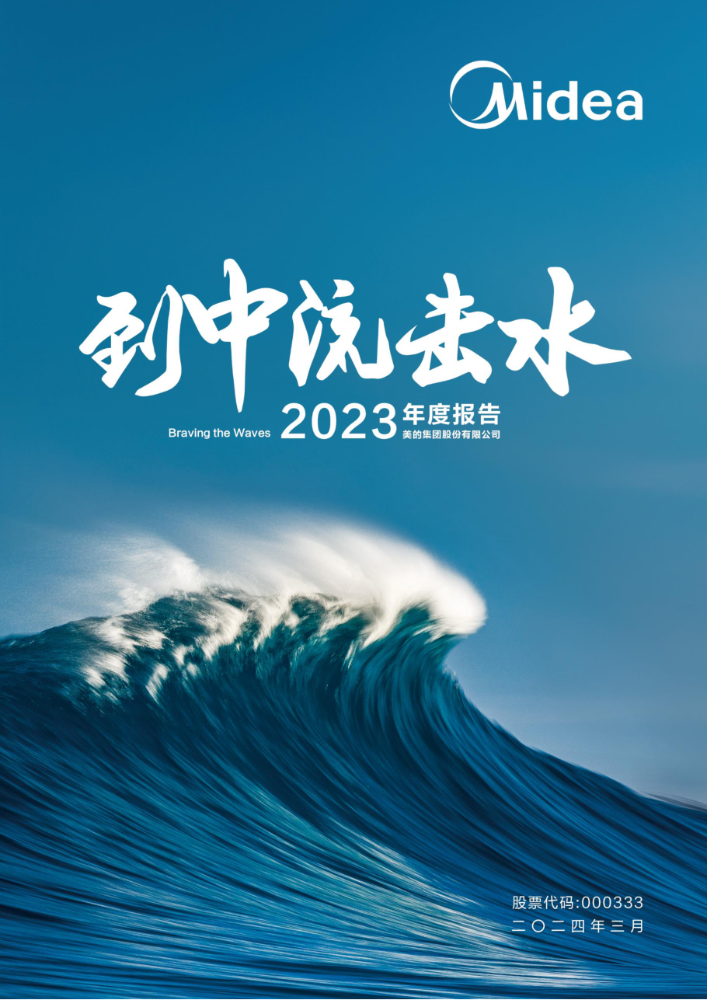
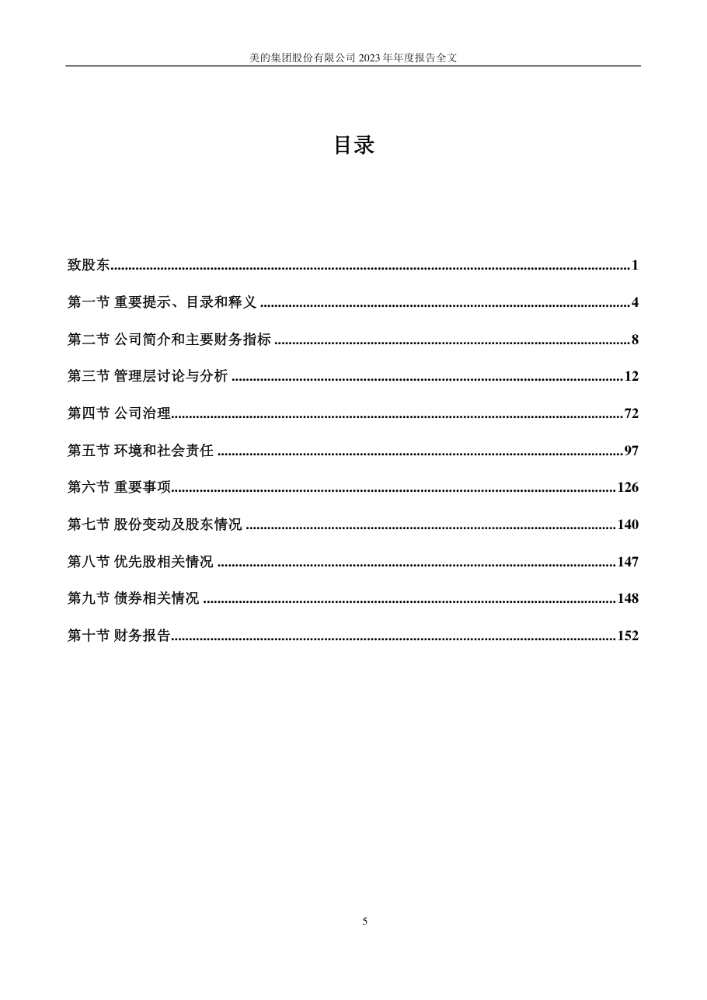
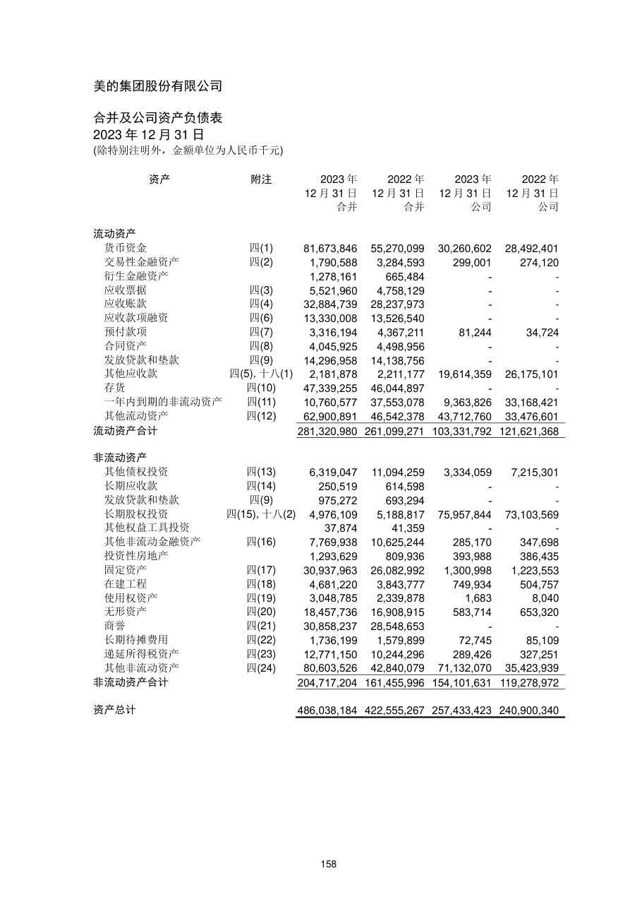
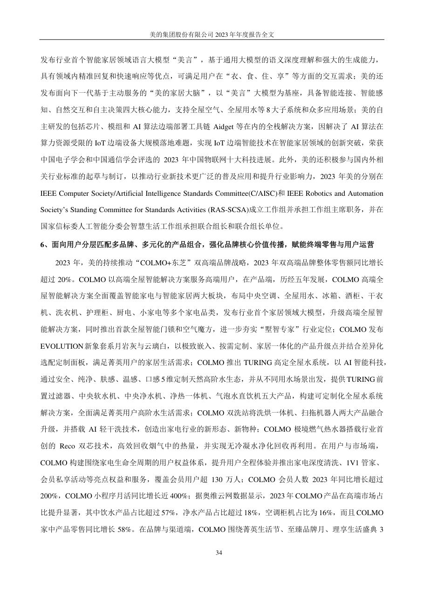
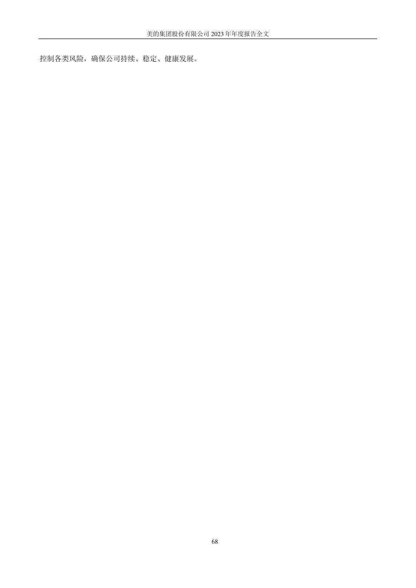
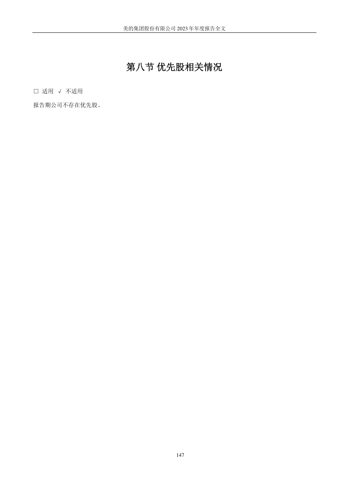

# 000333_2023 页面解析人工抽查

- 样本数：6
- 当前状态：待人工确认

## 验收清单

- [ ] 页面图像与提取文本属于同一PDF物理页
- [ ] 公司、报告年度和报告类型正确
- [ ] 目录章节与页码关系未明显错乱
- [ ] 正文阅读顺序基本正确且无大面积乱码
- [ ] 财务表格的项目、单位和关键数字可对应
- [ ] 异常页属于合理短页/封面/签署页，而非正文漏提取

## cover - PDF第1页

- 抽查原因：PDF封面与报告身份核验
- 印刷页码：None
- 章节：unknown
- 字符数：17
- 质量标记：['short_page']



### 提取文本

```text
2023 年年度报告
2024 年03 月
```

## table_of_contents - PDF第6页

- 抽查原因：目录与章节页码核验
- 印刷页码：5
- 章节：第一节 重要提示、目录和释义
- 字符数：1413
- 质量标记：[]



### 提取文本

```text
目录
致股东 .................................................................................................................................................. 1
第一节 重要提示、目录和释义 ........................................................................................................ 4
第二节 公司简介和主要财务指标 .................................................................................................... 8
第三节 管理层讨论与分析 .............................................................................................................. 12
第四节 公司治理............................................................................................................................... 72
第五节 环境和社会责任 .................................................................................................................. 97
第六节 重要事项............................................................................................................................. 126
第七节 股份变动及股东情况 ........................................................................................................ 140
第八节 优先股相关情况 ................................................................................................................ 147
第九节 债券相关情况 .................................................................................................................... 148
第十节 财务报告............................................................................................................................. 152
5
```

## financial_table - PDF第159页

- 抽查原因：财务表格行列、数字和单位核验
- 印刷页码：158
- 章节：六、 注册会计师对财务报表审计的责任(续)
- 字符数：1328
- 质量标记：[]



### 提取文本

```text
合并及公司资产负债表
2023 年12 月31 日
资产 附注 2023 年 2022 年 2023 年 2022 年
12 月31 日 12 月31 日 12 月31 日 12 月31 日
合并 合并 公司 公司
流动资产
货币资金 四(1) 81,673,846 55,270,099 30,260,602 28,492,401
交易性金融资产 四(2) 1,790,588 3,284,593 299,001 274,120
衍生金融资产 1,278,161 665,484 - -
应收票据 四(3) 5,521,960 4,758,129 - -
应收账款 四(4) 32,884,739 28,237,973 - -
应收款项融资 四(6) 13,330,008 13,526,540 - -
预付款项 四(7) 3,316,194 4,367,211 81,244 34,724
合同资产 四(8) 4,045,925 4,498,956 - -
发放贷款和垫款 四(9) 14,296,958 14,138,756 - -
其他应收款 四(5),十八(1) 2,181,878 2,211,177 19,614,359 26,175,101
存货 四(10) 47,339,255 46,044,897 - -
一年内到期的非流动资产 四(11) 10,760,577 37,553,078 9,363,826 33,168,421
其他流动资产 四(12) 62,900,891 46,542,378 43,712,760 33,476,601
流动资产合计 281,320,980 261,099,271 103,331,792 121,621,368
非流动资产
其他债权投资 四(13) 6,319,047 11,094,259 3,334,059 7,215,301
长期应收款 四(14) 250,519 614,598 - -
发放贷款和垫款 四(9) 975,272 693,294 - -
长期股权投资 四(15),十八(2) 4,976,109 5,188,817 75,957,844 73,103,569
其他权益工具投资 37,874 41,359 - -
其他非流动金融资产 四(16) 7,769,938 10,625,244 285,170 347,698
投资性房地产 1,293,629 809,936 393,988 386,435
固定资产 四(17) 30,937,963 26,082,992 1,300,998 1,223,553
在建工程 四(18) 4,681,220 3,843,777 749,934 504,757
使用权资产 四(19) 3,048,785 2,339,878 1,683 8,040
无形资产 四(20) 18,457,736 16,908,915 583,714 653,320
商誉 四(21) 30,858,237 28,548,653 - -
长期待摊费用 四(22) 1,736,199 1,579,899 72,745 85,109
递延所得税资产 四(23) 12,771,150 10,244,296 289,426 327,251
其他非流动资产 四(24) 80,603,526 42,840,079 71,132,070 35,423,939
非流动资产合计 204,717,204 161,455,996 154,101,631 119,278,972
资产总计 486,038,184 422,555,267 257,433,423 240,900,340
158
```

## body_text - PDF第35页

- 抽查原因：普通正文顺序与可读性核验
- 印刷页码：34
- 章节：第三节 管理层讨论与分析
- 字符数：1435
- 质量标记：[]



### 提取文本

```text
发布行业首个智能家居领域语言大模型“美言”，基于通用大模型的语义深度理解和强大的生成能力，
具有领域内精准回复和快速响应等优点，可满足用户在“衣、食、住、享”等方面的交互需求；美的还
发布面向下一代基于主动服务的“美的家居大脑”，以“美言”大模型为基座，具备智能连接、智能感
知、自然交互和自主决策四大核心能力，支持全屋空气、全屋用水等8 大子系统和众多应用场景；美的自
主研发的包括芯片、模组和AI 算法边端部署工具链Aidget 等在内的全栈解决方案，因解决了AI 算法在
算力资源受限的IoT 边端设备大规模落地难题，实现IoT 边端智能技术在智能家居领域的创新突破，荣获
中国电子学会和中国通信学会评选的2023 年中国物联网十大科技进展。此外，美的还积极参与国内外相
关行业标准的起草与制订，以推动行业新技术更广泛的普及应用和提升行业影响力，2023 年美的分别在
IEEE Computer Society/Artificial Intelligence Standards Committee(C/AISC)和IEEE Robotics and Automation
Society’s Standing Committee for Standards Activities (RAS-SCSA)成立工作组并承担工作组主席职务，并在
国家信标委人工智能分委会智慧生活工作组承担联合组长和联合组长单位。
6、面向用户分层匹配多品牌、多元化的产品组合，强化品牌核心价值传播，赋能终端零售与用户运营
2023 年，美的持续推动“COLMO+东芝”双高端品牌战略，2023 年双高端品牌整体零售额同比增长
超过20%。COLMO 以高端全屋智能解决方案服务高端用户，在产品端，历经五年发展，COLMO 高端全
屋智能解决方案全面覆盖智能家电与智能家居两大板块，布局中央空调、全屋用水、冰箱、酒柜、干衣
机、洗衣机、护理柜、厨电、小家电等多个家电品类，发布行业首个家居领域大模型，升级高端全屋智
能解决方案，同时推出首款全屋智能门锁和空气魔方，进一步夯实“墅智专家”行业定位；COLMO 发布
EVOLUTION新象套系月岩灰与云璃白，以极致嵌入、按需定制、家居一体化的产品升级点并结合差异化
选配定制面板，满足菁英用户的家居生活需求；COLMO 推出TURING 高定全屋水系统，以AI 智能科技，
通过安全、纯净、肤感、温感、口感5维定制天然高阶水生态，并从不同用水场景出发，提供TURING前
置过滤器、中央软水机、中央净水机、净热一体机、气泡水直饮机五大产品，构建可定制化全屋水系统
解决方案，全面满足菁英用户高阶水生活需求；COLMO 双洗站将洗烘一体机、扫拖机器人两大产品融合
升级，并搭载AI 轻干洗技术，创造出家电行业的新形态、新物种；COLMO 极境燃气热水器搭载行业首
创的Reco 双芯技术，高效回收烟气中的热量，并实现无冷凝水净化回收再利用。在用户与市场端，
COLMO 构建围绕家电生命全周期的用户权益体系，提升用户全程体验并推出家电深度清洗、1V1 管家、
会员私享活动等亮点权益和服务，覆盖会员用户超130 万人；COLMO 会员人数2023 年同比增长超过
200%，COLMO 小程序月活同比增长近400%；据奥维云网数据显示，2023 年COLMO 产品在高端市场占
比提升显著，其中饮水产品占比超过57%，净水产品占比超过18%，空调柜机占比为16%，而且COLMO
家中产品零售同比增长58%。在品牌与渠道端，COLMO 围绕菁英生活节、至臻品牌月、理享生活盛典3
34
```

## flagged_page - PDF第69页

- 抽查原因：异常页复核：short_page
- 印刷页码：68
- 章节：五、非主营业务分析
- 字符数：24
- 质量标记：['short_page']



### 提取文本

```text
控制各类风险，确保公司持续、稳定、健康发展。
68
```

## flagged_page - PDF第148页

- 抽查原因：异常页复核：short_page
- 印刷页码：147
- 章节：第八节 优先股相关情况
- 字符数：32
- 质量标记：['short_page']



### 提取文本

```text
第八节 优先股相关情况
□ 适用 √ 不适用
报告期公司不存在优先股。
147
```
