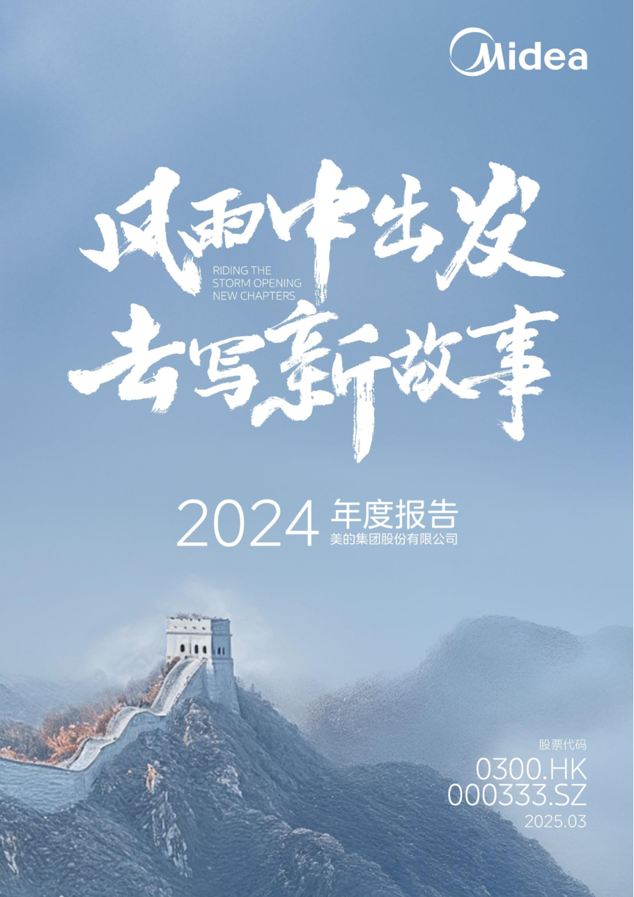
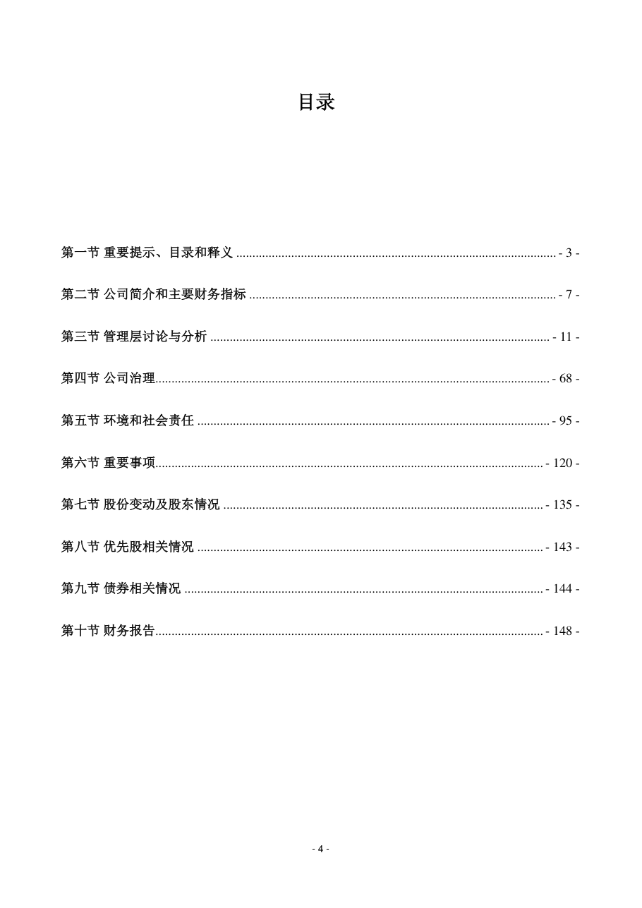
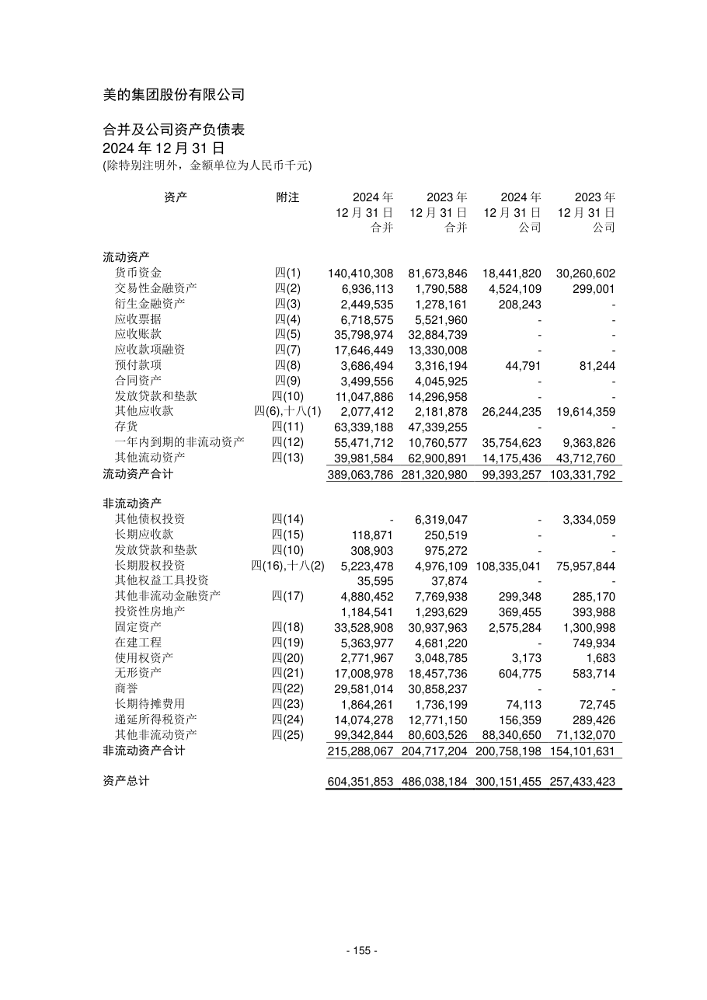
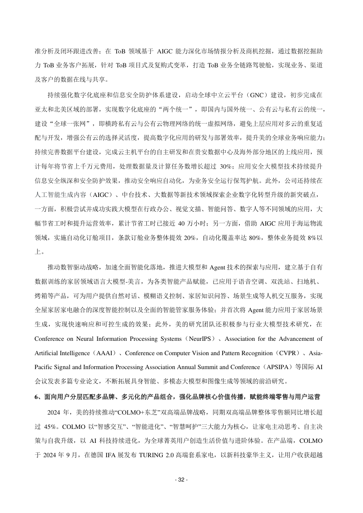
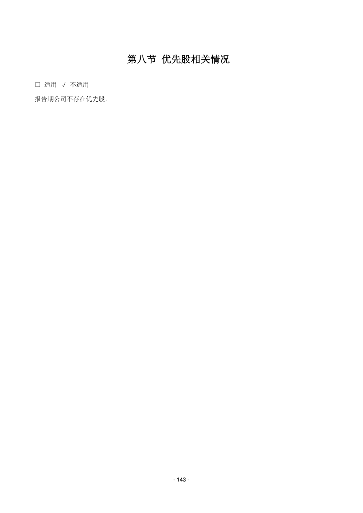

# 000333_2024 页面解析人工抽查

- 样本数：6
- 当前状态：待人工确认

## 验收清单

- [ ] 页面图像与提取文本属于同一PDF物理页
- [ ] 公司、报告年度和报告类型正确
- [ ] 目录章节与页码关系未明显错乱
- [ ] 正文阅读顺序基本正确且无大面积乱码
- [ ] 财务表格的项目、单位和关键数字可对应
- [ ] 异常页属于合理短页/封面/签署页，而非正文漏提取

## cover - PDF第1页

- 抽查原因：PDF封面与报告身份核验
- 印刷页码：None
- 章节：unknown
- 字符数：16
- 质量标记：['short_page']



### 提取文本

```text
2024 年度报告
2025 年03 月
```

## table_of_contents - PDF第5页

- 抽查原因：目录与章节页码核验
- 印刷页码：4
- 章节：第一节 重要提示、目录和释义
- 字符数：1235
- 质量标记：[]



### 提取文本

```text
目录
第一节 重要提示、目录和释义 ................................................................................................... - 3 -
第二节 公司简介和主要财务指标 ............................................................................................... - 7 -
第三节 管理层讨论与分析 ......................................................................................................... - 11 -
第四节 公司治理.......................................................................................................................... - 68 -
第五节 环境和社会责任 ............................................................................................................. - 95 -
第六节 重要事项........................................................................................................................ - 120 -
第七节 股份变动及股东情况 ................................................................................................... - 135 -
第八节 优先股相关情况 ........................................................................................................... - 143 -
第九节 债券相关情况 ............................................................................................................... - 144 -
第十节 财务报告........................................................................................................................ - 148 -
- 4 -
```

## financial_table - PDF第156页

- 抽查原因：财务表格行列、数字和单位核验
- 印刷页码：155
- 章节：六、 注册会计师对财务报表审计的责任(续)
- 字符数：1325
- 质量标记：[]



### 提取文本

```text
合并及公司资产负债表
2024 年12 月31 日
资产 附注 2024 年 2023 年 2024 年 2023 年
12 月31 日 12 月31 日 12 月31 日 12 月31 日
合并 合并 公司 公司
流动资产
货币资金 四(1) 140,410,308 81,673,846 18,441,820 30,260,602
交易性金融资产 四(2) 6,936,113 1,790,588 4,524,109 299,001
衍生金融资产 四(3) 2,449,535 1,278,161 208,243 -
应收票据 四(4) 6,718,575 5,521,960 - -
应收账款 四(5) 35,798,974 32,884,739 - -
应收款项融资 四(7) 17,646,449 13,330,008 - -
预付款项 四(8) 3,686,494 3,316,194 44,791 81,244
合同资产 四(9) 3,499,556 4,045,925 - -
发放贷款和垫款 四(10) 11,047,886 14,296,958 - -
其他应收款 四(6),十八(1) 2,077,412 2,181,878 26,244,235 19,614,359
存货 四(11) 63,339,188 47,339,255 - -
一年内到期的非流动资产 四(12) 55,471,712 10,760,577 35,754,623 9,363,826
其他流动资产 四(13) 39,981,584 62,900,891 14,175,436 43,712,760
流动资产合计 389,063,786 281,320,980 99,393,257 103,331,792
非流动资产
其他债权投资 四(14) - 6,319,047 - 3,334,059
长期应收款 四(15) 118,871 250,519 - -
发放贷款和垫款 四(10) 308,903 975,272 - -
长期股权投资 四(16),十八(2) 5,223,478 4,976,109 108,335,041 75,957,844
其他权益工具投资 35,595 37,874 - -
其他非流动金融资产 四(17) 4,880,452 7,769,938 299,348 285,170
投资性房地产 1,184,541 1,293,629 369,455 393,988
固定资产 四(18) 33,528,908 30,937,963 2,575,284 1,300,998
在建工程 四(19) 5,363,977 4,681,220 - 749,934
使用权资产 四(20) 2,771,967 3,048,785 3,173 1,683
无形资产 四(21) 17,008,978 18,457,736 604,775 583,714
商誉 四(22) 29,581,014 30,858,237 - -
长期待摊费用 四(23) 1,864,261 1,736,199 74,113 72,745
递延所得税资产 四(24) 14,074,278 12,771,150 156,359 289,426
其他非流动资产 四(25) 99,342,844 80,603,526 88,340,650 71,132,070
非流动资产合计 215,288,067 204,717,204 200,758,198 154,101,631
资产总计 604,351,853 486,038,184 300,151,455 257,433,423
- 155 -
```

## body_text - PDF第33页

- 抽查原因：普通正文顺序与可读性核验
- 印刷页码：32
- 章节：第三节 管理层讨论与分析
- 字符数：1373
- 质量标记：[]



### 提取文本

```text
准分析及闭环跟进改善；在ToB 领域基于AIGC 能力深化市场情报分析及商机挖掘，通过数据挖掘助
力ToB 业务客户拓展，针对ToB 项目式及复购式变革，打造ToB 业务全链路驾驶舱，实现业务、渠道
及客户的数据在线与共享。
持续强化数字化底座和信息安全防护体系建设，启动全球中立云平台（GNC）建设，初步完成在
亚太和北美区域的部署，实现数字化底座的“两个统一”，即国内与国外统一、公有云与私有云的统一，
建设“全球一张网”，即横跨私有云与公有云物理网络的统一虚拟网络，避免上层应用对多云的重复适
配与开发，增强公有云的选择灵活度，提高数字化应用的研发与部署效率，提升美的全球业务响应能力；
持续完善数据平台建设，完成云主机平台的自主研发和在贵安数据中心及海外部分地区的上线应用，预
计每年将节省上千万元费用，处理数据量及计算任务数增长超过30%；应用安全大模型技术持续提升
信息安全纵深和安全防护效果，推动安全响应自动化，为业务安全运行保驾护航。此外，公司还持续在
人工智能生成内容（AIGC）、中台技术、大数据等新技术领域探索企业数字化转型升级的新突破点，
一方面，积极尝试并成功实践大模型在行政办公、视觉文描、智能问答、数字人等不同领域的应用，大
幅节省工时和提升运营效率，累计节省工时已接近40 万小时；另一方面，借助AIGC 应用于海运物流
领域，实施自动化订舱项目，条款订舱业务整体提效20%，自动化覆盖率达80%，整体业务提效8%以
上。
推动数智驱动战略，加速全面智能化落地，推进大模型和Agent 技术的探索与应用，建立基于自有
数据训练的家居领域语言大模型-美言，为各类智能产品赋能，已应用于语音空调、双洗站、扫地机、
烤箱等产品，可为用户提供自然对话、模糊语义控制、家居知识问答、场景生成等人机交互服务，实现
全屋家居家电融合的深度智能控制以及全面的智能管家服务体验；并首次将Agent 能力应用于家居场景
生成，实现快速响应和可控生成的效果；此外，美的研究团队还积极参与行业大模型技术研究，在
Conference on Neural Information Processing Systems（NeurIPS）、Association for the Advancement of
Artificial Intelligence（AAAI）、Conference on Computer Vision and Pattern Recognition（CVPR）、Asia-
Pacific Signal and Information Processing Association Annual Summit and Conference（APSIPA）等国际AI
会议发表多篇专业论文，不断拓展具身智能、多模态大模型和图像生成等领域的前沿研究。
6、面向用户分层匹配多品牌、多元化的产品组合，强化品牌核心价值传播，赋能终端零售与用户运营
2024 年，美的持续推动“COLMO+东芝”双高端品牌战略，同期双高端品牌整体零售额同比增长超
过45%。COLMO 以“智感交互”、“智能进化”、“智慧呵护”三大能力为核心，让家电主动思考、自主决
策与自我升级，以AI 科技持续进化，为全球菁英用户创造生活价值与进阶体验。在产品端，COLMO
于2024 年9 月，在德国IFA 展发布TURING 2.0 高端套系家电，以新科技豪华主义，让用户收获超越
- 32 -
```

## flagged_page - PDF第135页

- 抽查原因：异常页复核：short_page
- 印刷页码：134
- 章节：十七、公司子公司重大事项
- 字符数：24
- 质量标记：['short_page']


### 提取文本

```text
十七、公司子公司重大事项
□ 适用 √ 不适用
- 134 -
```

## flagged_page - PDF第144页

- 抽查原因：异常页复核：short_page
- 印刷页码：143
- 章节：第八节 优先股相关情况
- 字符数：34
- 质量标记：['short_page']



### 提取文本

```text
第八节 优先股相关情况
□ 适用 √ 不适用
报告期公司不存在优先股。
- 143 -
```
