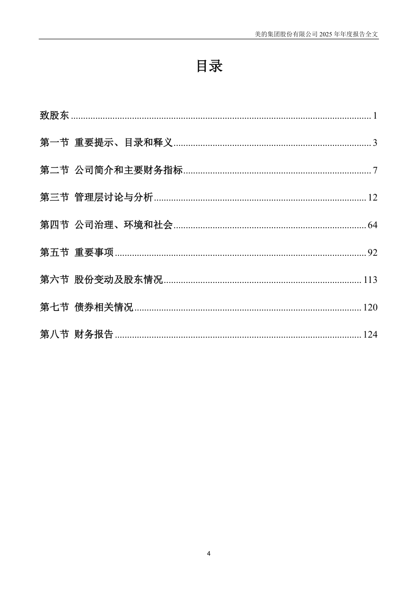
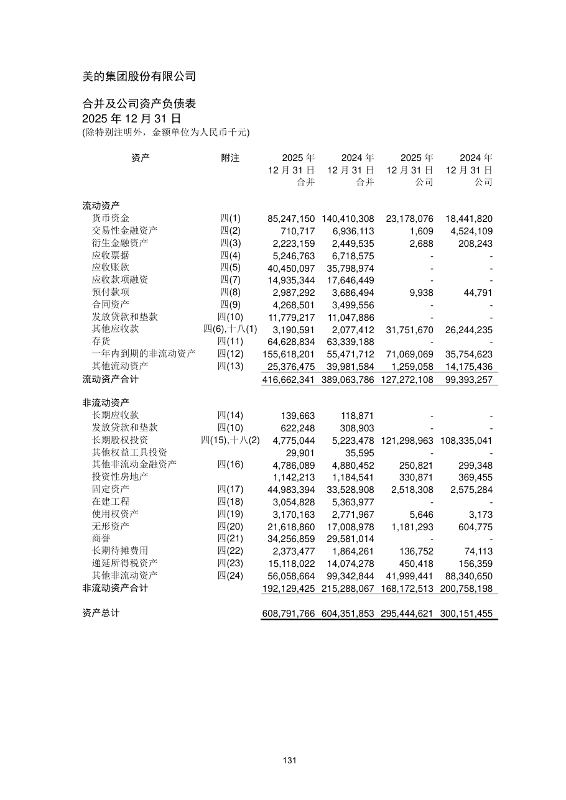
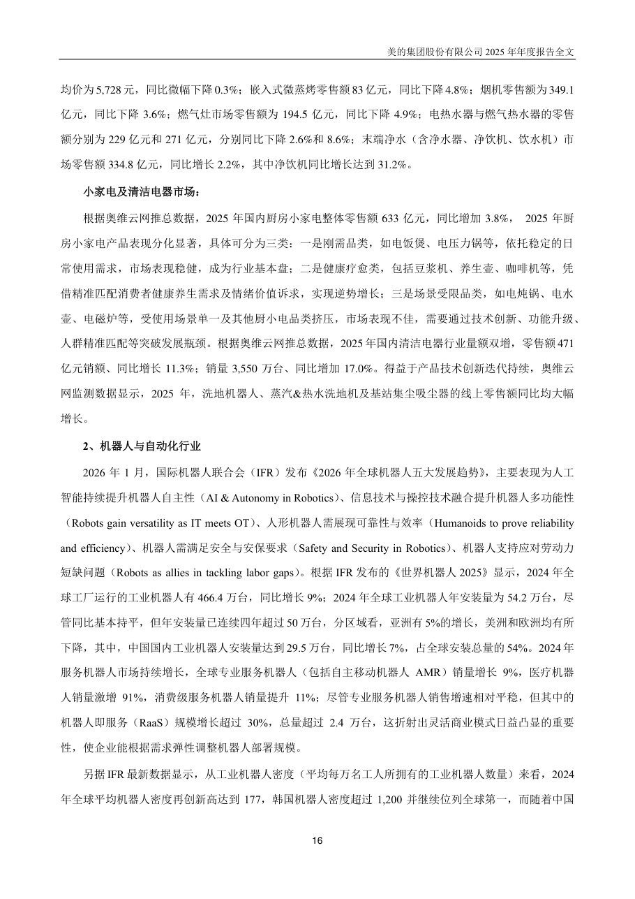

# 000333_2025 页面解析人工抽查

- 样本数：7
- 当前状态：待人工确认

## 验收清单

- [ ] 页面图像与提取文本属于同一PDF物理页
- [ ] 公司、报告年度和报告类型正确
- [ ] 目录章节与页码关系未明显错乱
- [ ] 正文阅读顺序基本正确且无大面积乱码
- [ ] 财务表格的项目、单位和关键数字可对应
- [ ] 异常页属于合理短页/封面/签署页，而非正文漏提取

## cover - PDF第1页

- 抽查原因：PDF封面与报告身份核验
- 印刷页码：None
- 章节：unknown
- 字符数：16
- 质量标记：['short_page']


### 提取文本

```text
2025 年年度报告
2026 年3 月
```

## table_of_contents - PDF第5页

- 抽查原因：目录与章节页码核验
- 印刷页码：4
- 章节：第一节 重要提示、目录和释义
- 字符数：935
- 质量标记：[]



### 提取文本

```text
目录
致股东 ........................................................................................................................... 1
第一节 重要提示、目录和释义 ................................................................................. 3
第二节 公司简介和主要财务指标 ............................................................................. 7
第三节 管理层讨论与分析 ....................................................................................... 12
第四节 公司治理、环境和社会 ............................................................................... 64
第五节 重要事项 ....................................................................................................... 92
第六节 股份变动及股东情况 ................................................................................. 113
第七节 债券相关情况 ............................................................................................. 120
第八节 财务报告 ..................................................................................................... 124
4
```

## financial_table - PDF第132页

- 抽查原因：财务表格行列、数字和单位核验
- 印刷页码：131
- 章节：六、 注册会计师对财务报表审计的责任（续）
- 字符数：1290
- 质量标记：[]



### 提取文本

```text
合并及公司资产负债表
2025 年12 月31 日
资产 附注 2025 年 2024 年 2025 年 2024 年
12 月31 日 12 月31 日 12 月31 日 12 月31 日
合并 合并 公司 公司
流动资产
货币资金 四(1) 85,247,150 140,410,308 23,178,076 18,441,820
交易性金融资产 四(2) 710,717 6,936,113 1,609 4,524,109
衍生金融资产 四(3) 2,223,159 2,449,535 2,688 208,243
应收票据 四(4) 5,246,763 6,718,575 - -
应收账款 四(5) 40,450,097 35,798,974 - -
应收款项融资 四(7) 14,935,344 17,646,449 - -
预付款项 四(8) 2,987,292 3,686,494 9,938 44,791
合同资产 四(9) 4,268,501 3,499,556 - -
发放贷款和垫款 四(10) 11,779,217 11,047,886 - -
其他应收款 四(6),十八(1) 3,190,591 2,077,412 31,751,670 26,244,235
存货 四(11) 64,628,834 63,339,188 - -
一年内到期的非流动资产 四(12) 155,618,201 55,471,712 71,069,069 35,754,623
其他流动资产 四(13) 25,376,475 39,981,584 1,259,058 14,175,436
流动资产合计 416,662,341 389,063,786 127,272,108 99,393,257
非流动资产
长期应收款 四(14) 139,663 118,871 - -
发放贷款和垫款 四(10) 622,248 308,903 - -
长期股权投资 四(15),十八(2) 4,775,044 5,223,478 121,298,963 108,335,041
其他权益工具投资 29,901 35,595 - -
其他非流动金融资产 四(16) 4,786,089 4,880,452 250,821 299,348
投资性房地产 1,142,213 1,184,541 330,871 369,455
固定资产 四(17) 44,983,394 33,528,908 2,518,308 2,575,284
在建工程 四(18) 3,054,828 5,363,977 - -
使用权资产 四(19) 3,170,163 2,771,967 5,646 3,173
无形资产 四(20) 21,618,860 17,008,978 1,181,293 604,775
商誉 四(21) 34,256,859 29,581,014 - -
长期待摊费用 四(22) 2,373,477 1,864,261 136,752 74,113
递延所得税资产 四(23) 15,118,022 14,074,278 450,418 156,359
其他非流动资产 四(24) 56,058,664 99,342,844 41,999,441 88,340,650
非流动资产合计 192,129,425 215,288,067 168,172,513 200,758,198
资产总计 608,791,766 604,351,853 295,444,621 300,151,455
131
```

## body_text - PDF第17页

- 抽查原因：普通正文顺序与可读性核验
- 印刷页码：16
- 章节：第三节 管理层讨论与分析
- 字符数：1328
- 质量标记：[]



### 提取文本

```text
均价为5,728 元，同比微幅下降0.3%；嵌入式微蒸烤零售额83 亿元，同比下降4.8%；烟机零售额为349.1
亿元，同比下降3.6%；燃气灶市场零售额为194.5 亿元，同比下降4.9%；电热水器与燃气热水器的零售
额分别为229 亿元和271 亿元，分别同比下降2.6%和8.6%；末端净水（含净水器、净饮机、饮水机）市
场零售额334.8 亿元，同比增长2.2%，其中净饮机同比增长达到31.2%。
小家电及清洁电器市场：
根据奥维云网推总数据，2025 年国内厨房小家电整体零售额633 亿元，同比增加3.8%， 2025 年厨
房小家电产品表现分化显著，具体可分为三类：一是刚需品类，如电饭煲、电压力锅等，依托稳定的日
常使用需求，市场表现稳健，成为行业基本盘；二是健康疗愈类，包括豆浆机、养生壶、咖啡机等，凭
借精准匹配消费者健康养生需求及情绪价值诉求，实现逆势增长；三是场景受限品类，如电炖锅、电水
壶、电磁炉等，受使用场景单一及其他厨小电品类挤压，市场表现不佳，需要通过技术创新、功能升级、
人群精准匹配等突破发展瓶颈。根据奥维云网推总数据，2025 年国内清洁电器行业量额双增，零售额471
亿元销额、同比增长11.3%；销量3,550 万台、同比增加17.0%。得益于产品技术创新迭代持续，奥维云
网监测数据显示，2025 年，洗地机器人、蒸汽&热水洗地机及基站集尘吸尘器的线上零售额同比均大幅
增长。
2、机器人与自动化行业
2026 年1 月，国际机器人联合会（IFR）发布《2026 年全球机器人五大发展趋势》，主要表现为人工
智能持续提升机器人自主性（AI & Autonomy in Robotics）、信息技术与操控技术融合提升机器人多功能性
（Robots gain versatility as IT meets OT）、人形机器人需展现可靠性与效率（Humanoids to prove reliability
and efficiency）、机器人需满足安全与安保要求（Safety and Security in Robotics）、机器人支持应对劳动力
短缺问题（Robots as allies in tackling labor gaps）。根据IFR 发布的《世界机器人2025》显示，2024 年全
球工厂运行的工业机器人有466.4 万台，同比增长9%；2024 年全球工业机器人年安装量为54.2 万台，尽
管同比基本持平，但年安装量已连续四年超过50 万台，分区域看，亚洲有5%的增长，美洲和欧洲均有所
下降，其中，中国国内工业机器人安装量达到29.5 万台，同比增长7%，占全球安装总量的54%。2024 年
服务机器人市场持续增长，全球专业服务机器人（包括自主移动机器人AMR）销量增长9%，医疗机器
人销量激增91%，消费级服务机器人销量提升11%；尽管专业服务机器人销售增速相对平稳，但其中的
机器人即服务（RaaS）规模增长超过30%，总量超过2.4 万台，这折射出灵活商业模式日益凸显的重要
性，使企业能根据需求弹性调整机器人部署规模。
另据IFR 最新数据显示，从工业机器人密度（平均每万名工人所拥有的工业机器人数量）来看，2024
年全球平均机器人密度再创新高达到177，韩国机器人密度超过1,200 并继续位列全球第一，而随着中国
16
```

## flagged_page - PDF第12页

- 抽查原因：异常页复核：short_page
- 印刷页码：11
- 章节：九、非经常性损益项目及金额
- 字符数：20
- 质量标记：['short_page']


### 提取文本

```text
常性损益项目的情况说明
□ 适用 √ 不适用
11
```

## flagged_page - PDF第134页

- 抽查原因：异常页复核：short_page
- 印刷页码：133
- 章节：六、 注册会计师对财务报表审计的责任（续）
- 字符数：27
- 质量标记：['short_page']


### 提取文本

```text
法定代表人： 主管会计工作负责人：
会计机构负责人：
133
```

## flagged_page - PDF第138页

- 抽查原因：异常页复核：short_page
- 印刷页码：137
- 章节：一、经营活动产生/(使用)的现金流量
- 字符数：27
- 质量标记：['short_page']


### 提取文本

```text
法定代表人： 主管会计工作负责人：
会计机构负责人：
137
```
