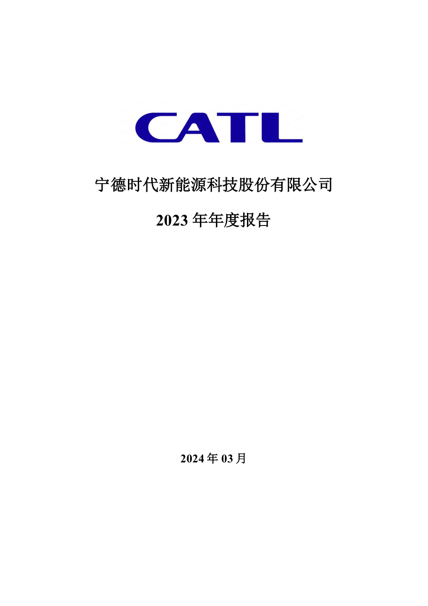
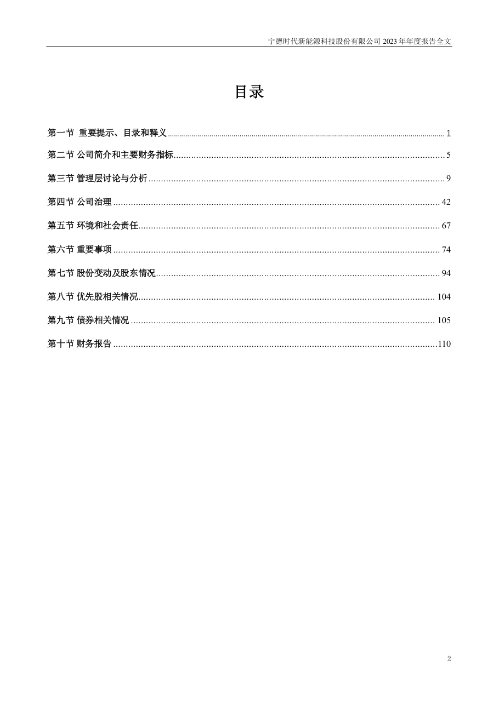
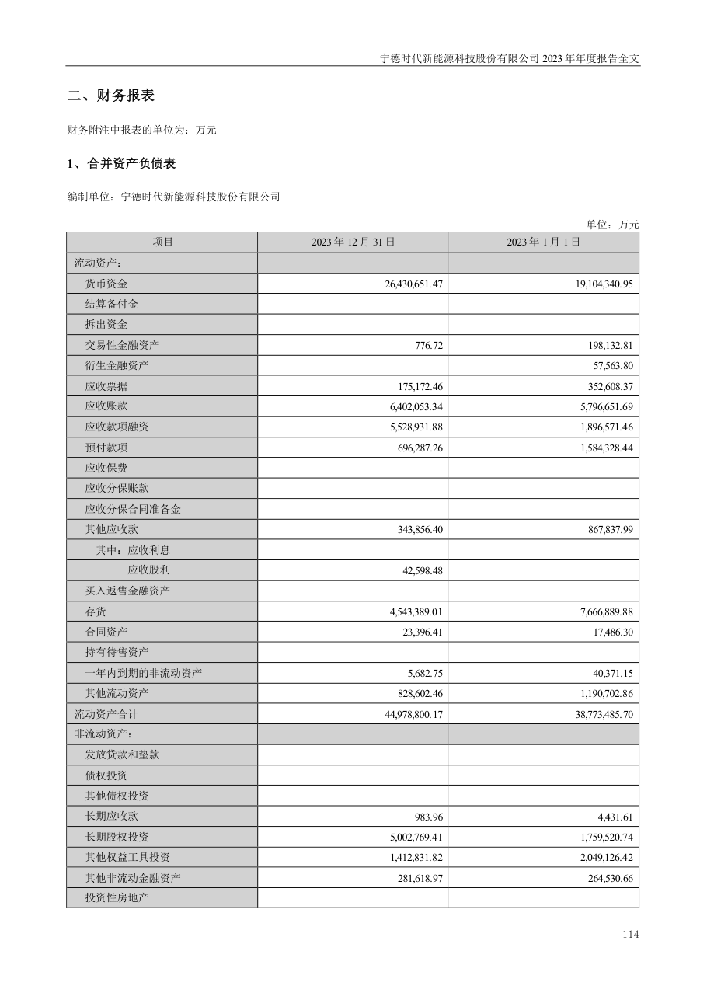
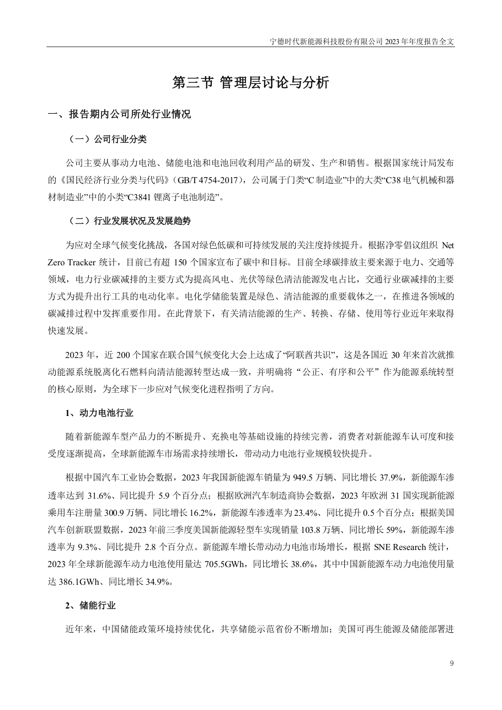

# 300750_2023 页面解析人工抽查

- 样本数：6
- 当前状态：待人工确认

## 验收清单

- [ ] 页面图像与提取文本属于同一PDF物理页
- [ ] 公司、报告年度和报告类型正确
- [ ] 目录章节与页码关系未明显错乱
- [ ] 正文阅读顺序基本正确且无大面积乱码
- [ ] 财务表格的项目、单位和关键数字可对应
- [ ] 异常页属于合理短页/封面/签署页，而非正文漏提取

## cover - PDF第1页

- 抽查原因：PDF封面与报告身份核验
- 印刷页码：None
- 章节：unknown
- 字符数：32
- 质量标记：['short_page']



### 提取文本

```text
宁德时代新能源科技股份有限公司
2023 年年度报告
2024 年03 月
```

## table_of_contents - PDF第3页

- 抽查原因：目录与章节页码核验
- 印刷页码：2
- 章节：第一节 重要提示、目录和释义
- 字符数：1348
- 质量标记：[]



### 提取文本

```text
目录
第一节 重要提示、目录和释义 .......................................................................................................................................... 1
第二节 公司简介和主要财务指标 ............................................................................................................ 5
第三节 管理层讨论与分析 ...................................................................................................................... 9
第四节 公司治理 .................................................................................................................................. 42
第五节 环境和社会责任 ........................................................................................................................ 67
第六节 重要事项 .................................................................................................................................. 74
第七节 股份变动及股东情况 ................................................................................................................. 94
第八节 优先股相关情况 ...................................................................................................................... 104
第九节 债券相关情况 ......................................................................................................................... 105
第十节 财务报告 .................................................................................................................................110
2
```

## financial_table - PDF第115页

- 抽查原因：财务表格行列、数字和单位核验
- 印刷页码：114
- 章节：二、财务报表
- 字符数：622
- 质量标记：[]



### 提取文本

```text
二、财务报表
财务附注中报表的单位为：万元
1、合并资产负债表
编制单位：宁德时代新能源科技股份有限公司
单位：万元
项目 2023 年12 月31 日 2023 年1 月1 日
流动资产：
货币资金 26,430,651.47 19,104,340.95
结算备付金
拆出资金
交易性金融资产 776.72 198,132.81
衍生金融资产 57,563.80
应收票据 175,172.46 352,608.37
应收账款 6,402,053.34 5,796,651.69
应收款项融资 5,528,931.88 1,896,571.46
预付款项 696,287.26 1,584,328.44
应收保费
应收分保账款
应收分保合同准备金
其他应收款 343,856.40 867,837.99
其中：应收利息
应收股利 42,598.48
买入返售金融资产
存货 4,543,389.01 7,666,889.88
合同资产 23,396.41 17,486.30
持有待售资产
一年内到期的非流动资产 5,682.75 40,371.15
其他流动资产 828,602.46 1,190,702.86
流动资产合计 44,978,800.17 38,773,485.70
非流动资产：
发放贷款和垫款
债权投资
其他债权投资
长期应收款 983.96 4,431.61
长期股权投资 5,002,769.41 1,759,520.74
其他权益工具投资 1,412,831.82 2,049,126.42
其他非流动金融资产 281,618.97 264,530.66
投资性房地产
114
```

## body_text - PDF第10页

- 抽查原因：普通正文顺序与可读性核验
- 印刷页码：9
- 章节：第三节 管理层讨论与分析
- 字符数：997
- 质量标记：[]



### 提取文本

```text
第三节 管理层讨论与分析
一、报告期内公司所处行业情况
（一）公司行业分类
公司主要从事动力电池、储能电池和电池回收利用产品的研发、生产和销售。根据国家统计局发布
的《国民经济行业分类与代码》（GB/T 4754-2017），公司属于门类“C 制造业”中的大类“C38 电气机械和器
材制造业”中的小类“C3841 锂离子电池制造”。
（二）行业发展状况及发展趋势
为应对全球气候变化挑战，各国对绿色低碳和可持续发展的关注度持续提升。根据净零倡议组织Net
Zero Tracker 统计，目前已有超150 个国家宣布了碳中和目标。目前全球碳排放主要来源于电力、交通等
领域，电力行业碳减排的主要方式为提高风电、光伏等绿色清洁能源发电占比，交通行业碳减排的主要
方式为提升出行工具的电动化率。电化学储能装置是绿色、清洁能源的重要载体之一，在推进各领域的
碳减排过程中发挥重要作用。在此背景下，有关清洁能源的生产、转换、存储、使用等行业近年来取得
快速发展。
2023 年，近200 个国家在联合国气候变化大会上达成了“阿联酋共识”，这是各国近30 年来首次就推
动能源系统脱离化石燃料向清洁能源转型达成一致，并明确将“公正、有序和公平”作为能源系统转型
的核心原则，为全球下一步应对气候变化进程指明了方向。
1、动力电池行业
随着新能源车型产品力的不断提升、充换电等基础设施的持续完善，消费者对新能源车认可度和接
受度逐渐提高，全球新能源车市场需求持续增长，带动动力电池行业规模较快提升。
根据中国汽车工业协会数据，2023 年我国新能源车销量为949.5 万辆、同比增长37.9%，新能源车渗
透率达到31.6%、同比提升5.9 个百分点；根据欧洲汽车制造商协会数据，2023 年欧洲31 国实现新能源
乘用车注册量300.9 万辆、同比增长16.2%，新能源车渗透率为23.4%、同比提升0.5个百分点；根据美国
汽车创新联盟数据，2023 年前三季度美国新能源轻型车实现销量103.8 万辆、同比增长59%，新能源车渗
透率为9.3%、同比提升2.8 个百分点。新能源车增长带动动力电池市场增长，根据SNE Research 统计，
2023 年全球新能源车动力电池使用量达705.5GWh，同比增长38.6%，其中中国新能源车动力电池使用量
达386.1GWh、同比增长34.9%。
2、储能行业
近年来，中国储能政策环境持续优化，共享储能示范省份不断增加；美国可再生能源及储能部署进
9
```

## flagged_page - PDF第104页

- 抽查原因：异常页复核：short_page
- 印刷页码：103
- 章节：四、股份回购在报告期的具体实施情况
- 字符数：10
- 质量标记：['short_page']


### 提取文本

```text
□适用 不适用
103
```

## flagged_page - PDF第105页

- 抽查原因：异常页复核：short_page
- 印刷页码：104
- 章节：第八节 优先股相关情况
- 字符数：32
- 质量标记：['short_page']


### 提取文本

```text
第八节 优先股相关情况
□适用 不适用
报告期公司不存在优先股。
104
```
