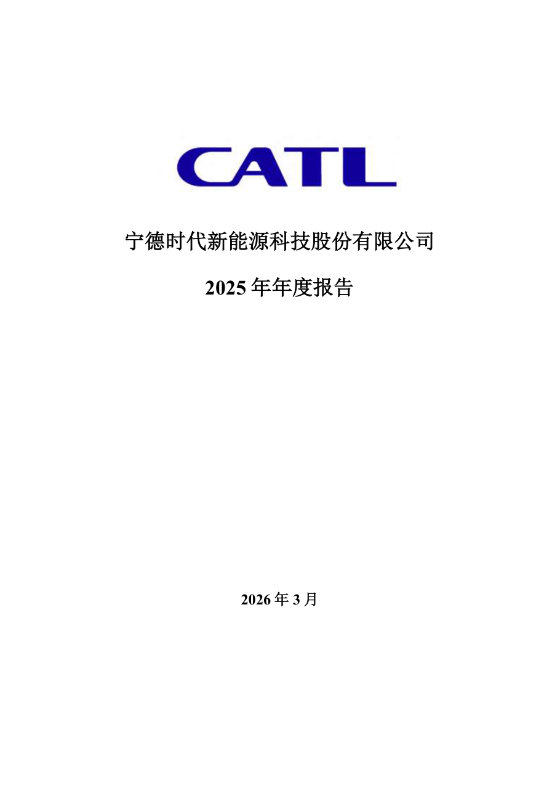
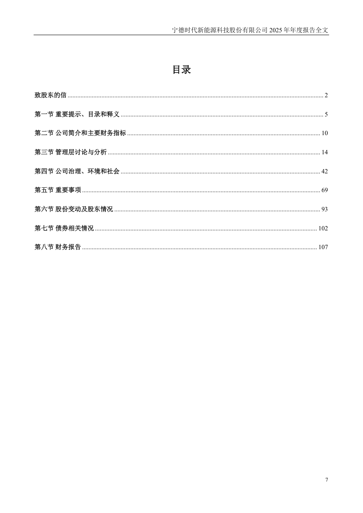
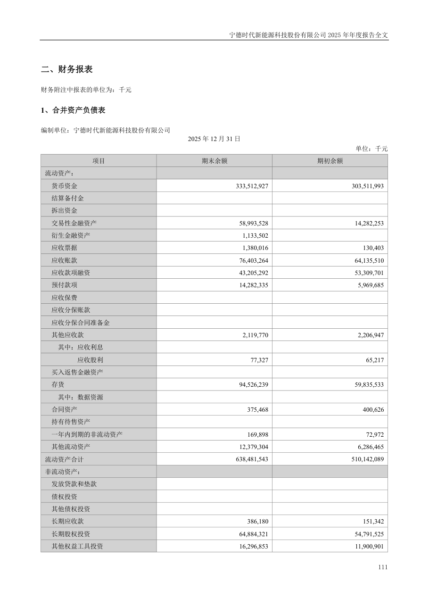
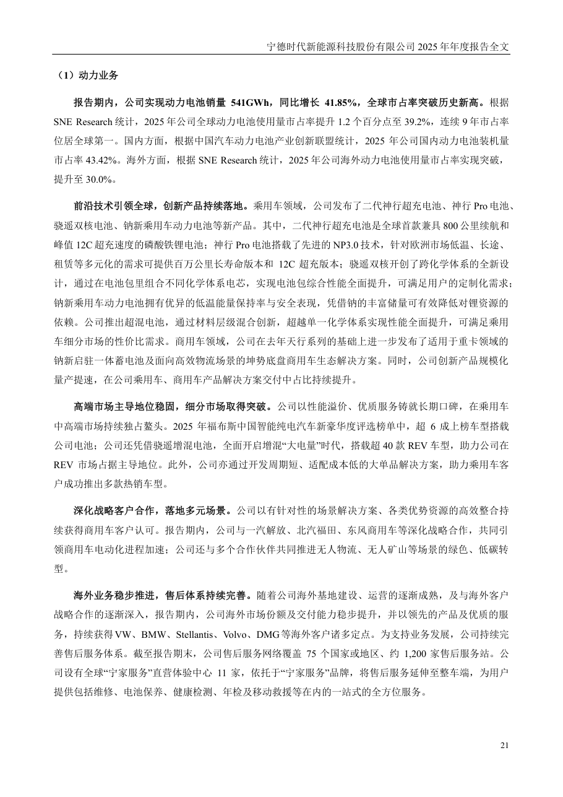
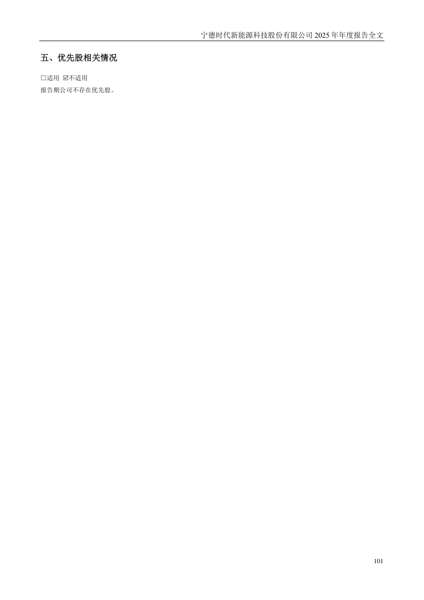

# 300750_2025 页面解析人工抽查

- 样本数：5
- 当前状态：待人工确认

## 验收清单

- [ ] 页面图像与提取文本属于同一PDF物理页
- [ ] 公司、报告年度和报告类型正确
- [ ] 目录章节与页码关系未明显错乱
- [ ] 正文阅读顺序基本正确且无大面积乱码
- [ ] 财务表格的项目、单位和关键数字可对应
- [ ] 异常页属于合理短页/封面/签署页，而非正文漏提取

## cover - PDF第1页

- 抽查原因：PDF封面与报告身份核验
- 印刷页码：None
- 章节：unknown
- 字符数：31
- 质量标记：['short_page']



### 提取文本

```text
宁德时代新能源科技股份有限公司
2025 年年度报告
2026 年3 月
```

## table_of_contents - PDF第7页

- 抽查原因：目录与章节页码核验
- 印刷页码：7
- 章节：八、董事会审议的报告期利润分配预案或公积金转增股本预案
- 字符数：1333
- 质量标记：[]



### 提取文本

```text
目录
致股东的信 ............................................................................................................................................................... 2
第一节 重要提示、目录和释义 .............................................................................................................................. 5
第二节 公司简介和主要财务指标 ........................................................................................................................ 10
第三节 管理层讨论与分析 .................................................................................................................................... 14
第四节 公司治理、环境和社会 ............................................................................................................................ 42
第五节 重要事项 .................................................................................................................................................... 69
第六节 股份变动及股东情况 ................................................................................................................................ 93
第七节 债券相关情况 .......................................................................................................................................... 102
第八节 财务报告 .................................................................................................................................................. 107
7
```

## financial_table - PDF第111页

- 抽查原因：财务表格行列、数字和单位核验
- 印刷页码：111
- 章节：二、财务报表
- 字符数：552
- 质量标记：[]



### 提取文本

```text
二、财务报表
财务附注中报表的单位为：千元
1、合并资产负债表
编制单位：宁德时代新能源科技股份有限公司
2025 年12 月31 日
单位：千元
项目 期末余额 期初余额
流动资产：
货币资金 333,512,927 303,511,993
结算备付金
拆出资金
交易性金融资产 58,993,528 14,282,253
衍生金融资产 1,133,502
应收票据 1,380,016 130,403
应收账款 76,403,264 64,135,510
应收款项融资 43,205,292 53,309,701
预付款项 14,282,335 5,969,685
应收保费
应收分保账款
应收分保合同准备金
其他应收款 2,119,770 2,206,947
其中：应收利息
应收股利 77,327 65,217
买入返售金融资产
存货 94,526,239 59,835,533
其中：数据资源
合同资产 375,468 400,626
持有待售资产
一年内到期的非流动资产 169,898 72,972
其他流动资产 12,379,304 6,286,465
流动资产合计 638,481,543 510,142,089
非流动资产：
发放贷款和垫款
债权投资
其他债权投资
长期应收款 386,180 151,342
长期股权投资 64,884,321 54,791,525
其他权益工具投资 16,296,853 11,900,901
111
```

## body_text - PDF第21页

- 抽查原因：普通正文顺序与可读性核验
- 印刷页码：21
- 章节：第三节 管理层讨论与分析
- 字符数：1278
- 质量标记：[]



### 提取文本

```text
（1）动力业务
报告期内，公司实现动力电池销量541GWh，同比增长41.85%，全球市占率突破历史新高。根据
SNE Research 统计，2025 年公司全球动力电池使用量市占率提升1.2 个百分点至39.2%，连续9 年市占率
位居全球第一。国内方面，根据中国汽车动力电池产业创新联盟统计，2025 年公司国内动力电池装机量
市占率43.42%。海外方面，根据SNE Research 统计，2025 年公司海外动力电池使用量市占率实现突破，
提升至30.0%。
前沿技术引领全球，创新产品持续落地。乘用车领域，公司发布了二代神行超充电池、神行Pro 电池、
骁遥双核电池、钠新乘用车动力电池等新产品。其中，二代神行超充电池是全球首款兼具800 公里续航和
峰值12C 超充速度的磷酸铁锂电池；神行Pro 电池搭载了先进的NP3.0 技术，针对欧洲市场低温、长途、
租赁等多元化的需求可提供百万公里长寿命版本和12C 超充版本；骁遥双核开创了跨化学体系的全新设
计，通过在电池包里组合不同化学体系电芯，实现电池包综合性能全面提升，可满足用户的定制化需求；
钠新乘用车动力电池拥有优异的低温能量保持率与安全表现，凭借钠的丰富储量可有效降低对锂资源的
依赖。公司推出超混电池，通过材料层级混合创新，超越单一化学体系实现性能全面提升，可满足乘用
车细分市场的性价比需求。商用车领域，公司在去年天行系列的基础上进一步发布了适用于重卡领域的
钠新启驻一体蓄电池及面向高效物流场景的坤势底盘商用车生态解决方案。同时，公司创新产品规模化
量产提速，在公司乘用车、商用车产品解决方案交付中占比持续提升。
高端市场主导地位稳固，细分市场取得突破。公司以性能溢价、优质服务铸就长期口碑，在乘用车
中高端市场持续独占鳌头。2025 年福布斯中国智能纯电汽车新豪华度评选榜单中，超6 成上榜车型搭载
公司电池；公司还凭借骁遥增混电池，全面开启增混“大电量”时代，搭载超40 款REV 车型，助力公司在
REV 市场占据主导地位。此外，公司亦通过开发周期短、适配成本低的大单品解决方案，助力乘用车客
户成功推出多款热销车型。
深化战略客户合作，落地多元场景。公司以有针对性的场景解决方案、各类优势资源的高效整合持
续获得商用车客户认可。报告期内，公司与一汽解放、北汽福田、东风商用车等深化战略合作，共同引
领商用车电动化进程加速；公司还与多个合作伙伴共同推进无人物流、无人矿山等场景的绿色、低碳转
型。
海外业务稳步推进，售后体系持续完善。随着公司海外基地建设、运营的逐渐成熟，及与海外客户
战略合作的逐渐深入，报告期内，公司海外市场份额及交付能力稳步提升，并以领先的产品及优质的服
务，持续获得VW、BMW、Stellantis、Volvo、DMG等海外客户诸多定点。为支持业务发展，公司持续完
善售后服务体系。截至报告期末，公司售后服务网络覆盖75 个国家或地区、约1,200 家售后服务站。公
司设有全球“宁家服务”直营体验中心11 家，依托于“宁家服务”品牌，将售后服务延伸至整车端，为用户
提供包括维修、电池保养、健康检测、年检及移动救援等在内的一站式的全方位服务。
21
```

## flagged_page - PDF第101页

- 抽查原因：异常页复核：short_page
- 印刷页码：101
- 章节：五、优先股相关情况
- 字符数：31
- 质量标记：['short_page']



### 提取文本

```text
五、优先股相关情况
□适用 不适用
报告期公司不存在优先股。
101
```
