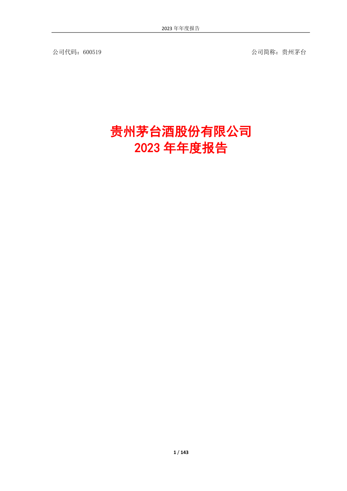
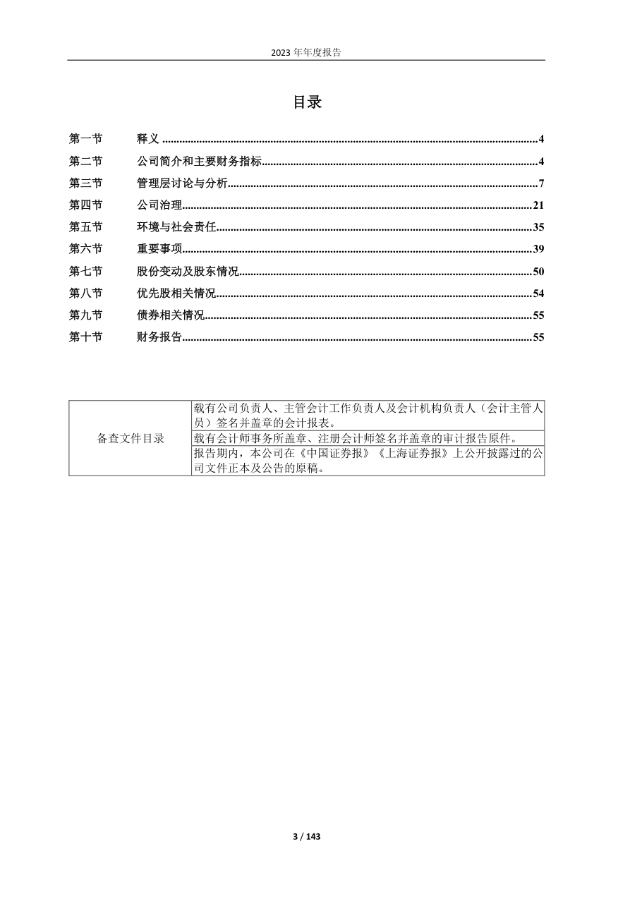
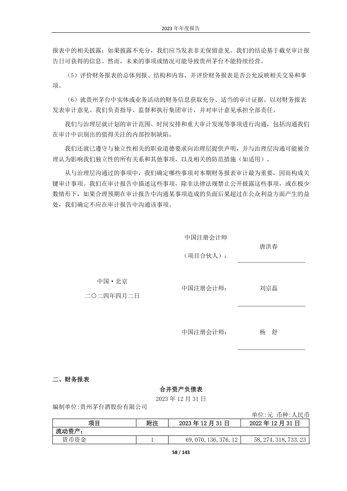
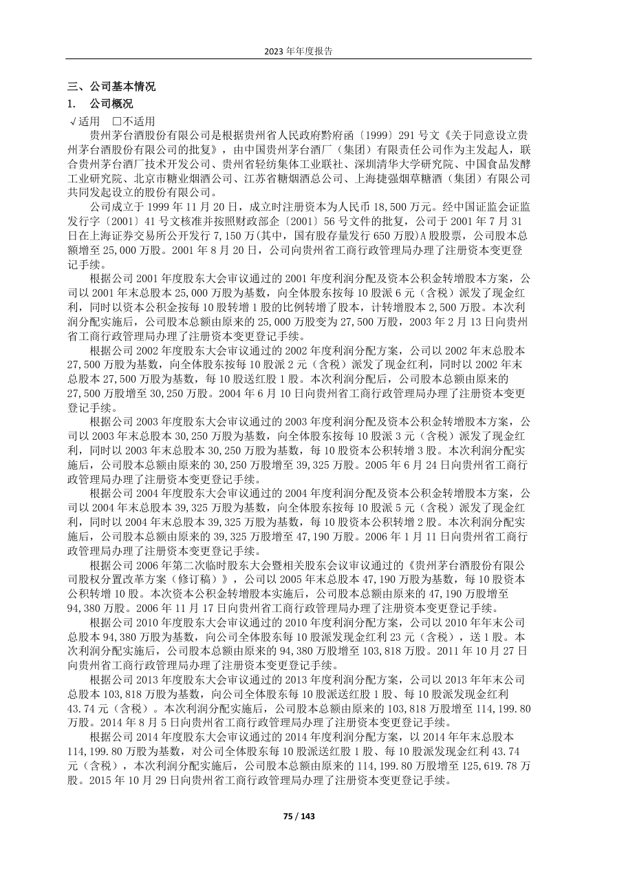
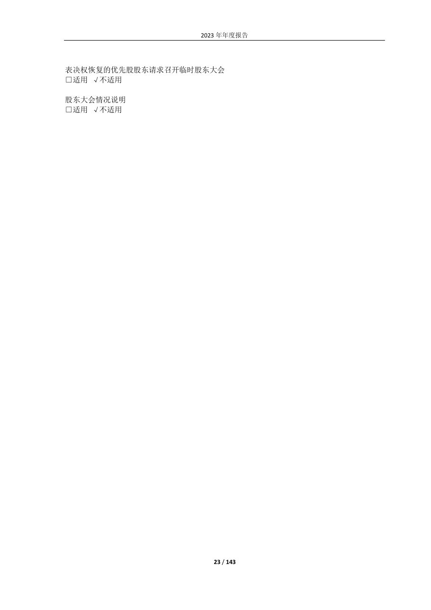

# 600519_2023 页面解析人工抽查

- 样本数：5
- 当前状态：待人工确认

## 验收清单

- [ ] 页面图像与提取文本属于同一PDF物理页
- [ ] 公司、报告年度和报告类型正确
- [ ] 目录章节与页码关系未明显错乱
- [ ] 正文阅读顺序基本正确且无大面积乱码
- [ ] 财务表格的项目、单位和关键数字可对应
- [ ] 异常页属于合理短页/封面/签署页，而非正文漏提取

## cover - PDF第1页

- 抽查原因：PDF封面与报告身份核验
- 印刷页码：None
- 章节：unknown
- 字符数：36
- 质量标记：['short_page']



### 提取文本

```text
公司代码：600519 公司简称：贵州茅台
贵州茅台酒股份有限公司
1 / 143
```

## table_of_contents - PDF第3页

- 抽查原因：目录与章节页码核验
- 印刷页码：None
- 章节：一、 本公司董事会、监事会及董事、监事、高级管理人员保证年度报告内容的真实性、准确性、
- 字符数：1385
- 质量标记：[]



### 提取文本

```text
目录
第一节 释义 .................................................................................................................................... 4
第二节 公司简介和主要财务指标 ................................................................................................. 4
第三节 管理层讨论与分析............................................................................................................. 7
第四节 公司治理........................................................................................................................... 21
第五节 环境与社会责任............................................................................................................... 35
第六节 重要事项........................................................................................................................... 39
第七节 股份变动及股东情况....................................................................................................... 50
第八节 优先股相关情况............................................................................................................... 54
第九节 债券相关情况................................................................................................................... 55
第十节 财务报告........................................................................................................................... 55
载有公司负责人、主管会计工作负责人及会计机构负责人（会计主管人
员）签名并盖章的会计报表。
备查文件目录 载有会计师事务所盖章、注册会计师签名并盖章的审计报告原件。
报告期内，本公司在《中国证券报》《上海证券报》上公开披露过的公
司文件正本及公告的原稿。
3 / 143
```

## financial_table - PDF第58页

- 抽查原因：财务表格行列、数字和单位核验
- 印刷页码：None
- 章节：四、其他信息
- 字符数：655
- 质量标记：[]



### 提取文本

```text
报表中的相关披露；如果披露不充分，我们应当发表非无保留意见。我们的结论基于截至审计报
告日可获得的信息。然而，未来的事项或情况可能导致贵州茅台不能持续经营。
（5）评价财务报表的总体列报、结构和内容，并评价财务报表是否公允反映相关交易和事
项。
（6）就贵州茅台中实体或业务活动的财务信息获取充分、适当的审计证据，以对财务报表
发表审计意见。我们负责指导、监督和执行集团审计，并对审计意见承担全部责任。
我们与治理层就计划的审计范围、时间安排和重大审计发现等事项进行沟通，包括沟通我们
在审计中识别出的值得关注的内部控制缺陷。
我们还就已遵守与独立性相关的职业道德要求向治理层提供声明，并与治理层沟通可能被合
理认为影响我们独立性的所有关系和其他事项，以及相关的防范措施（如适用）。
从与治理层沟通过的事项中，我们确定哪些事项对本期财务报表审计最为重要，因而构成关
键审计事项。我们在审计报告中描述这些事项，除非法律法规禁止公开披露这些事项，或在极少
数情形下，如果合理预期在审计报告中沟通某事项造成的负面后果超过在公众利益方面产生的益
处，我们确定不应在审计报告中沟通该事项。
中国注册会计师
唐洪春
（项目合伙人）：
中国·北京
中国注册会计师： 刘宗磊
二○二四年四月二日
中国注册会计师： 杨 舒
二、 财务报表
合并资产负债表
2023 年12 月31 日
编制单位:贵州茅台酒股份有限公司
单位:元 币种:人民币
项目 附注 2023 年12 月31 日 2022 年12 月31 日
流动资产：
货币资金 1 69,070,136,376.12 58,274,318,733.23
58 / 143
```

## body_text - PDF第75页

- 抽查原因：普通正文顺序与可读性核验
- 印刷页码：None
- 章节：三、 公司基本情况
- 字符数：1892
- 质量标记：[]



### 提取文本

```text
三、 公司基本情况
1. 公司概况
√适用 □不适用
贵州茅台酒股份有限公司是根据贵州省人民政府黔府函〔1999〕291 号文《关于同意设立贵
州茅台酒股份有限公司的批复》，由中国贵州茅台酒厂（集团）有限责任公司作为主发起人，联
合贵州茅台酒厂技术开发公司、贵州省轻纺集体工业联社、深圳清华大学研究院、中国食品发酵
工业研究院、北京市糖业烟酒公司、江苏省糖烟酒总公司、上海捷强烟草糖酒（集团）有限公司
共同发起设立的股份有限公司。
公司成立于1999 年11 月20 日，成立时注册资本为人民币18,500 万元。经中国证监会证监
发行字〔2001〕41 号文核准并按照财政部企〔2001〕56 号文件的批复，公司于2001 年7 月31
日在上海证券交易所公开发行7,150 万(其中，国有股存量发行650 万股)A 股股票，公司股本总
额增至25,000 万股。2001 年8 月20 日，公司向贵州省工商行政管理局办理了注册资本变更登
记手续。
根据公司2001 年度股东大会审议通过的2001 年度利润分配及资本公积金转增股本方案，公
司以2001 年末总股本25,000 万股为基数，向全体股东按每10 股派6 元（含税）派发了现金红
利，同时以资本公积金按每10 股转增1 股的比例转增了股本，计转增股本2,500 万股。本次利
润分配实施后，公司股本总额由原来的25,000 万股变为27,500 万股，2003 年2 月13 日向贵州
省工商行政管理局办理了注册资本变更登记手续。
根据公司2002 年度股东大会审议通过的2002 年度利润分配方案，公司以2002 年末总股本
27,500 万股为基数，向全体股东按每10 股派2 元（含税）派发了现金红利，同时以2002 年末
总股本27,500 万股为基数，每10 股送红股1 股。本次利润分配后，公司股本总额由原来的
27,500 万股增至30,250 万股。2004 年6 月10 日向贵州省工商行政管理局办理了注册资本变更
登记手续。
根据公司2003 年度股东大会审议通过的2003 年度利润分配及资本公积金转增股本方案，公
司以2003 年末总股本30,250 万股为基数，向全体股东按每10 股派3 元（含税）派发了现金红
利，同时以2003 年末总股本30,250 万股为基数，每10 股资本公积转增3 股。本次利润分配实
施后，公司股本总额由原来的30,250 万股增至39,325 万股。2005 年6 月24 日向贵州省工商行
政管理局办理了注册资本变更登记手续。
根据公司2004 年度股东大会审议通过的2004 年度利润分配及资本公积金转增股本方案，公
司以2004 年末总股本39,325 万股为基数，向全体股东按每10 股派5 元（含税）派发了现金红
利，同时以2004 年末总股本39,325 万股为基数，每10 股资本公积转增2 股。本次利润分配实
施后，公司股本总额由原来的39,325 万股增至47,190 万股。2006 年1 月11 日向贵州省工商行
政管理局办理了注册资本变更登记手续。
根据公司2006 年第二次临时股东大会暨相关股东会议审议通过的《贵州茅台酒股份有限公
司股权分置改革方案（修订稿）》，公司以2005 年末总股本47,190 万股为基数，每10 股资本
公积转增10 股。本次资本公积金转增股本实施后，公司股本总额由原来的47,190 万股增至
94,380 万股。2006 年11 月17 日向贵州省工商行政管理局办理了注册资本变更登记手续。
根据公司2010 年度股东大会审议通过的2010 年度利润分配方案，公司以2010 年年末公司
总股本94,380 万股为基数，向公司全体股东每10 股派发现金红利23 元（含税），送1 股。本
次利润分配实施后，公司股本总额由原来的94,380 万股增至103,818 万股。2011 年10 月27 日
向贵州省工商行政管理局办理了注册资本变更登记手续。
根据公司2013 年度股东大会审议通过的2013 年度利润分配方案，公司以2013 年年末公司
总股本103,818 万股为基数，向公司全体股东每10 股派送红股1 股、每10 股派发现金红利
43.74 元（含税）。本次利润分配实施后，公司股本总额由原来的103,818 万股增至114,199.80
万股。2014 年8 月5 日向贵州省工商行政管理局办理了注册资本变更登记手续。
根据公司2014 年度股东大会审议通过的2014 年度利润分配方案，以2014 年年末总股本
114,199.80 万股为基数，对公司全体股东每10 股派送红股1 股、每10 股派发现金红利43.74
元（含税），本次利润分配实施后，公司股本总额由原来的114,199.80 万股增至125,619.78 万
股。2015 年10 月29 日向贵州省工商行政管理局办理了注册资本变更登记手续。
75 / 143
```

## flagged_page - PDF第23页

- 抽查原因：异常页复核：short_page
- 印刷页码：None
- 章节：五、报告期内主要经营情况
- 字符数：49
- 质量标记：['short_page']



### 提取文本

```text
表决权恢复的优先股股东请求召开临时股东大会
□适用 √不适用
股东大会情况说明
□适用 √不适用
23 / 143
```
