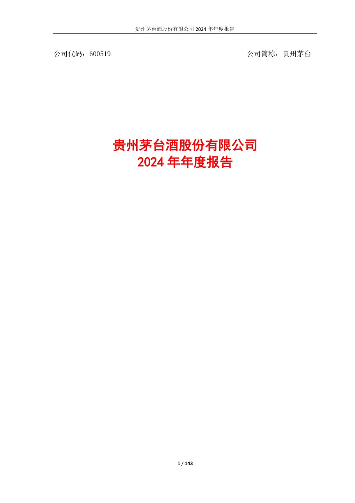
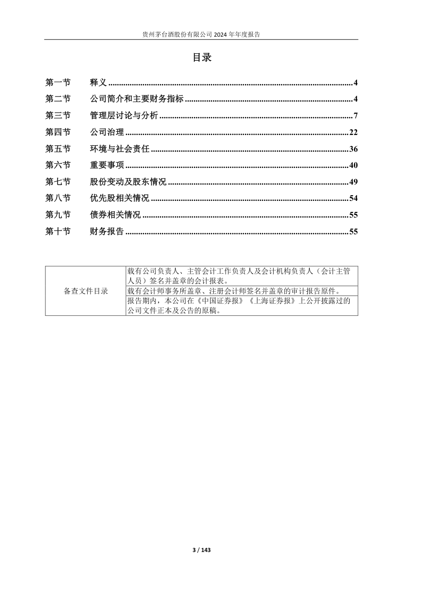
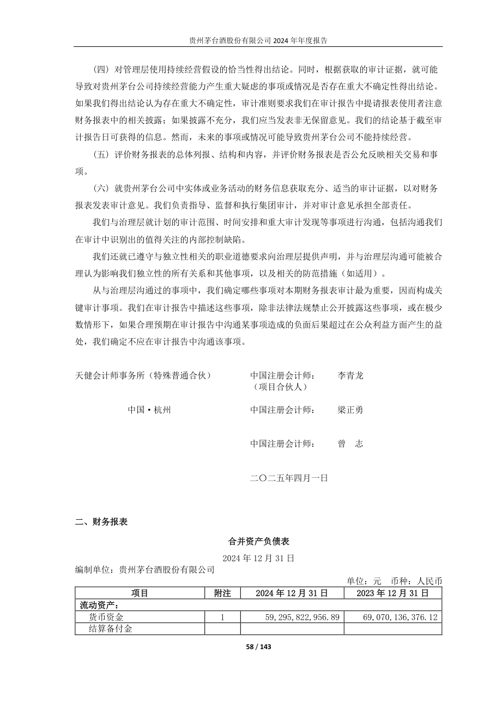
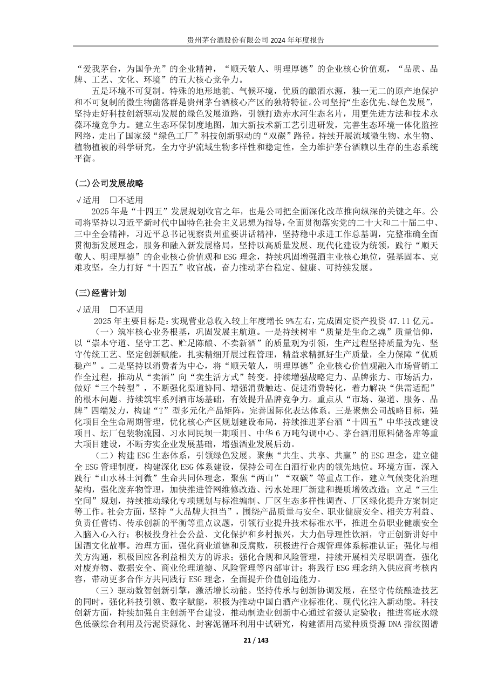

# 600519_2024 页面解析人工抽查

- 样本数：4
- 当前状态：待人工确认

## 验收清单

- [ ] 页面图像与提取文本属于同一PDF物理页
- [ ] 公司、报告年度和报告类型正确
- [ ] 目录章节与页码关系未明显错乱
- [ ] 正文阅读顺序基本正确且无大面积乱码
- [ ] 财务表格的项目、单位和关键数字可对应
- [ ] 异常页属于合理短页/封面/签署页，而非正文漏提取

## cover - PDF第1页

- 抽查原因：PDF封面与报告身份核验
- 印刷页码：None
- 章节：unknown
- 字符数：45
- 质量标记：['short_page']



### 提取文本

```text
公司代码：600519 公司简称：贵州茅台
贵州茅台酒股份有限公司
2024 年年度报告
1 / 143
```

## table_of_contents - PDF第3页

- 抽查原因：目录与章节页码核验
- 印刷页码：None
- 章节：一、 本公司董事会、监事会及董事、监事、高级管理人员保证年度报告内容的真实性、准确性、
- 字符数：1206
- 质量标记：[]



### 提取文本

```text
目录
第一节 释义 ................................................................................................................... 4
第二节 公司简介和主要财务指标 ............................................................................... 4
第三节 管理层讨论与分析 ........................................................................................... 7
第四节 公司治理 ......................................................................................................... 22
第五节 环境与社会责任 ............................................................................................. 36
第六节 重要事项 ......................................................................................................... 40
第七节 股份变动及股东情况 ..................................................................................... 49
第八节 优先股相关情况 ............................................................................................. 54
第九节 债券相关情况 ................................................................................................. 55
第十节 财务报告 ......................................................................................................... 55
载有公司负责人、主管会计工作负责人及会计机构负责人（会计主管
人员）签名并盖章的会计报表。
备查文件目录 载有会计师事务所盖章、注册会计师签名并盖章的审计报告原件。
报告期内，本公司在《中国证券报》《上海证券报》上公开披露过的
公司文件正本及公告的原稿。
3 / 143
```

## financial_table - PDF第58页

- 抽查原因：财务表格行列、数字和单位核验
- 印刷页码：None
- 章节：四、其他信息
- 字符数：806
- 质量标记：[]



### 提取文本

```text
(四) 对管理层使用持续经营假设的恰当性得出结论。同时，根据获取的审计证据，就可能
导致对贵州茅台公司持续经营能力产生重大疑虑的事项或情况是否存在重大不确定性得出结论。
如果我们得出结论认为存在重大不确定性，审计准则要求我们在审计报告中提请报表使用者注意
财务报表中的相关披露；如果披露不充分，我们应当发表非无保留意见。我们的结论基于截至审
计报告日可获得的信息。然而，未来的事项或情况可能导致贵州茅台公司不能持续经营。
(五) 评价财务报表的总体列报、结构和内容，并评价财务报表是否公允反映相关交易和事
项。
(六) 就贵州茅台公司中实体或业务活动的财务信息获取充分、适当的审计证据，以对财务
报表发表审计意见。我们负责指导、监督和执行集团审计，并对审计意见承担全部责任。
我们与治理层就计划的审计范围、时间安排和重大审计发现等事项进行沟通，包括沟通我们
在审计中识别出的值得关注的内部控制缺陷。
我们还就已遵守与独立性相关的职业道德要求向治理层提供声明，并与治理层沟通可能被合
理认为影响我们独立性的所有关系和其他事项，以及相关的防范措施（如适用）。
从与治理层沟通过的事项中，我们确定哪些事项对本期财务报表审计最为重要，因而构成关
键审计事项。我们在审计报告中描述这些事项，除非法律法规禁止公开披露这些事项，或在极少
数情形下，如果合理预期在审计报告中沟通某事项造成的负面后果超过在公众利益方面产生的益
处，我们确定不应在审计报告中沟通该事项。
天健会计师事务所（特殊普通合伙） 中国注册会计师： 李青龙
（项目合伙人）
中国·杭州 中国注册会计师： 梁正勇
中国注册会计师： 曾 志
二〇二五年四月一日
二、 财务报表
合并资产负债表
2024 年12 月31 日
编制单位：贵州茅台酒股份有限公司
单位：元 币种：人民币
项目 附注 2024 年12 月31 日 2023 年12 月31 日
流动资产：
货币资金 1 59,295,822,956.89 69,070,136,376.12
结算备付金
58 / 143
```

## body_text - PDF第21页

- 抽查原因：普通正文顺序与可读性核验
- 印刷页码：None
- 章节：四、报告期内核心竞争力分析
- 字符数：1754
- 质量标记：[]



### 提取文本

```text
“爱我茅台，为国争光”的企业精神，“顺天敬人、明理厚德”的企业核心价值观，“品质、品
牌、工艺、文化、环境”的五大核心竞争力。
五是环境不可复制。特殊的地形地貌、气候环境，优质的酿酒水源，独一无二的原产地保护
和不可复制的微生物菌落群是贵州茅台酒核心产区的独特特征。公司坚持“生态优先、绿色发展”，
坚持走好科技创新驱动发展的绿色发展道路，引领打造赤水河生态名片，用更先进方法和技术永
葆环境竞争力。建立生态环保制度地图，加大新技术新工艺引进研发，完善生态环境一体化监控
网络，走出了国家级“绿色工厂”科技创新驱动的“双碳”路径。持续开展流域微生物、水生物、
植物植被的科学研究，全力守护流域生物多样性和稳定性，全力维护茅台酒赖以生存的生态系统
平衡。
(二)公司发展战略
√适用 □不适用
2025 年是“十四五”发展规划收官之年，也是公司把全面深化改革推向纵深的关键之年。公
司将坚持以习近平新时代中国特色社会主义思想为指导，全面贯彻落实党的二十大和二十届二中、
三中全会精神，习近平总书记视察贵州重要讲话精神，坚持稳中求进工作总基调，完整准确全面
贯彻新发展理念，服务和融入新发展格局，坚持以高质量发展、现代化建设为统领，践行“顺天
敬人、明理厚德”的企业核心价值观和ESG 理念，持续巩固增强酒主业核心地位，强基固本、克
难攻坚，全力打好“十四五”收官战，奋力推动茅台稳定、健康、可持续发展。
(三)经营计划
√适用 □不适用
2025 年主要目标是：实现营业总收入较上年度增长9%左右，完成固定资产投资47.11 亿元。
（一）筑牢核心业务根基，巩固发展主航道。一是持续树牢“质量是生命之魂”质量信仰，
以“崇本守道、坚守工艺、贮足陈酿、不卖新酒”的质量观为引领，生产过程坚持质量为先、坚
守传统工艺、坚定创新赋能，扎实精细开展过程管理，精益求精抓好生产质量，全力保障“优质
稳产”。二是坚持以消费者为中心，将“顺天敬人，明理厚德”企业核心价值观融入市场营销工
作全过程，推动从“卖酒”向“卖生活方式”转变。持续增强战略定力、品牌张力、市场活力，
做好“三个转型”，不断强化渠道协同、增强消费触达、促进消费转化，着力解决“供需适配”
的根本问题。持续筑牢系列酒市场基础，有效提升品牌竞争力。重点从“市场、渠道、服务、品
牌”四端发力，构建“T”型多元化产品矩阵，完善国际化表达体系。三是聚焦公司战略目标，强
化项目全生命周期管理，优化核心产区规划建设布局，持续推进茅台酒“十四五”中华技改建设
项目、坛厂包装物流园、习水同民坝一期项目、中华6 万吨勾调中心、茅台酒用原料储备库等重
大项目建设，不断夯实企业发展基础，增强酒业发展后劲。
（二）构建ESG 生态体系，引领绿色发展。聚焦“共生、共享、共赢”的ESG 理念，建立健
全ESG 管理制度，构建深化ESG 体系建设，保持公司在白酒行业内的领先地位。环境方面，深入
践行“山水林土河微”生命共同体理念，聚焦“两山”“双碳”等重点工作，建立气候变化治理
架构，强化废弃物管理，加快推进管网维修改造、污水处理厂新建和提质增效改造；立足“三生
空间”规划，持续推动绿化专项规划与标准编制、厂区生态多样性调查、厂区绿化提升方案制定
等工作。社会方面，坚持“大品牌大担当”，围绕产品质量与安全、职业健康安全、相关方利益、
负责任营销、传承创新的平衡等重点议题，引领行业提升技术标准水平，推进全员职业健康安全
入脑入心入行；积极投身社会公益、文化保护和乡村振兴，大力倡导理性饮酒，守正创新讲好中
国酒文化故事。治理方面，强化商业道德和反腐败，积极进行合规管理体系标准认证；强化与相
关方沟通，积极回应各利益相关方的诉求；强化合规和风险管理，持续开展相关尽职调查，强化
对废弃物、数据安全、商业伦理道德、风险管理等内部审计；将践行ESG 理念纳入供应商考核内
容，带动更多合作方共同践行ESG 理念，全面提升价值创造能力。
（三）驱动数智创新引擎，激活增长动能。坚持传承与创新协调发展，在坚守传统酿造技艺
的同时，强化科技引领、数字赋能，积极为推动中国白酒产业标准化、现代化注入新动能。科技
创新方面，持续加强自主创新平台建设，推动制造业创新中心通过省级认定验收；推进窖底水绿
色低碳综合利用及污泥资源化、封窖泥循环利用中试研究，构建酒用高粱种质资源DNA 指纹图谱
21 / 143
```
