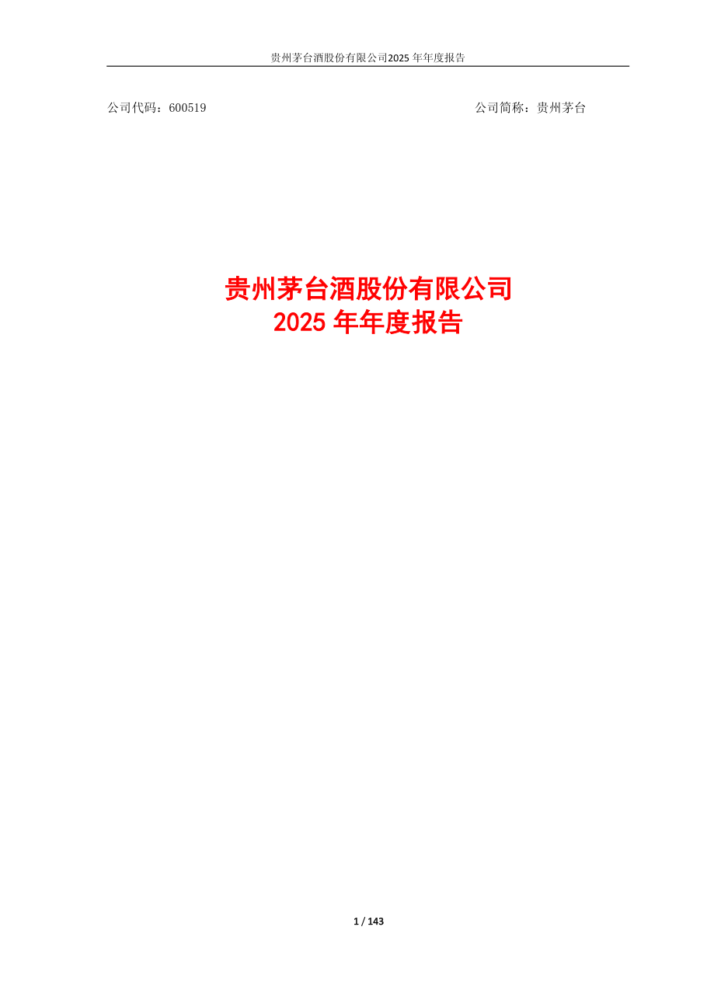
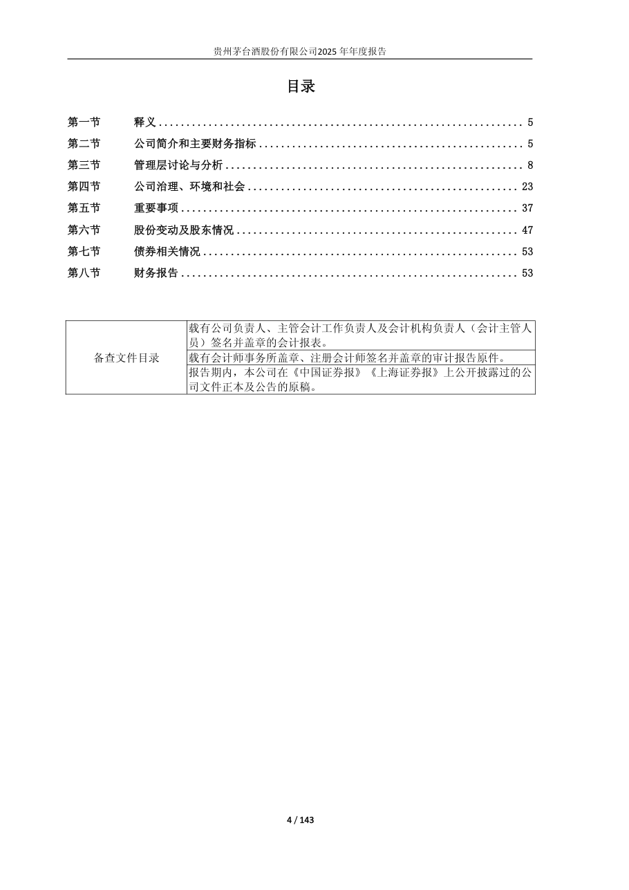
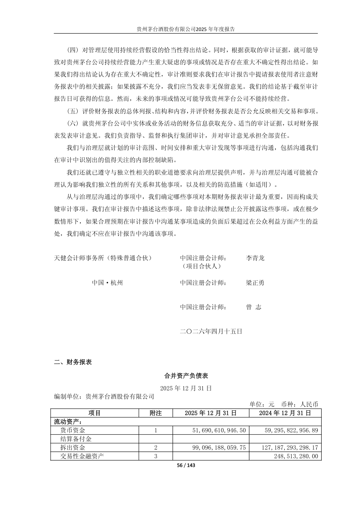
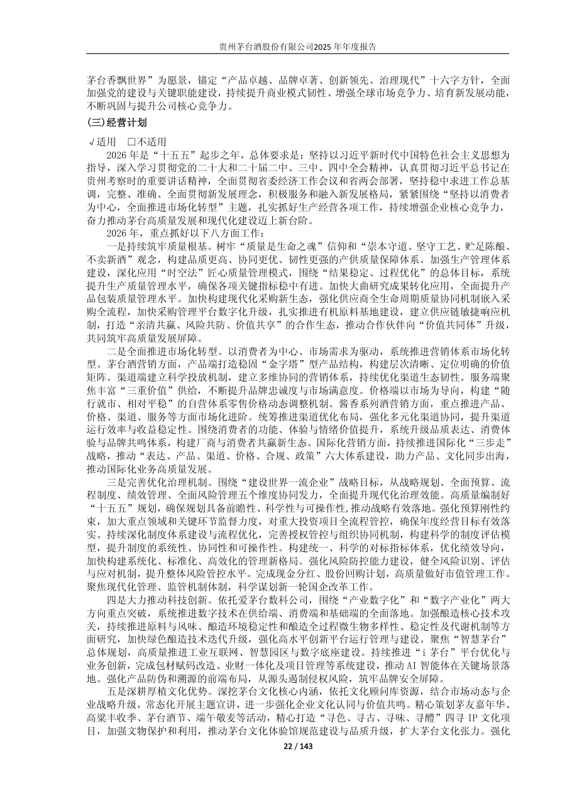
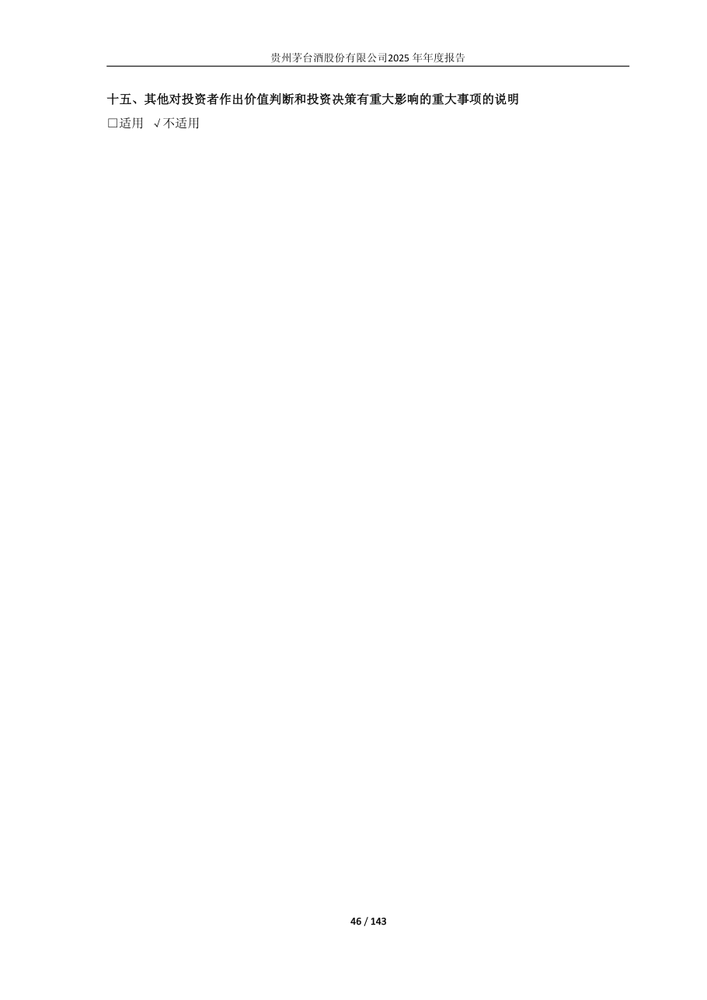

# 600519_2025 页面解析人工抽查

- 样本数：5
- 当前状态：待人工确认

## 验收清单

- [ ] 页面图像与提取文本属于同一PDF物理页
- [ ] 公司、报告年度和报告类型正确
- [ ] 目录章节与页码关系未明显错乱
- [ ] 正文阅读顺序基本正确且无大面积乱码
- [ ] 财务表格的项目、单位和关键数字可对应
- [ ] 异常页属于合理短页/封面/签署页，而非正文漏提取

## cover - PDF第1页

- 抽查原因：PDF封面与报告身份核验
- 印刷页码：None
- 章节：unknown
- 字符数：45
- 质量标记：['short_page']



### 提取文本

```text
公司代码：600519 公司简称：贵州茅台
贵州茅台酒股份有限公司
2025 年年度报告
1 / 143
```

## table_of_contents - PDF第4页

- 抽查原因：目录与章节页码核验
- 印刷页码：None
- 章节：十、 重大风险提示
- 字符数：667
- 质量标记：[]



### 提取文本

```text
目录
第一节 释义.................................................................. 5
第二节 公司简介和主要财务指标................................................ 5
第三节 管理层讨论与分析...................................................... 8
第四节 公司治理、环境和社会................................................. 23
第五节 重要事项............................................................. 37
第六节 股份变动及股东情况................................................... 47
第七节 债券相关情况......................................................... 53
第八节 财务报告............................................................. 53
载有公司负责人、主管会计工作负责人及会计机构负责人（会计主管人
员）签名并盖章的会计报表。
备查文件目录 载有会计师事务所盖章、注册会计师签名并盖章的审计报告原件。
报告期内，本公司在《中国证券报》《上海证券报》上公开披露过的公
司文件正本及公告的原稿。
4 / 143
```

## financial_table - PDF第56页

- 抽查原因：财务表格行列、数字和单位核验
- 印刷页码：None
- 章节：四、其他信息
- 字符数：869
- 质量标记：[]



### 提取文本

```text
(四) 对管理层使用持续经营假设的恰当性得出结论。同时，根据获取的审计证据，就可能导
致对贵州茅台公司持续经营能力产生重大疑虑的事项或情况是否存在重大不确定性得出结论。如
果我们得出结论认为存在重大不确定性，审计准则要求我们在审计报告中提请报表使用者注意财
务报表中的相关披露；如果披露不充分，我们应当发表非无保留意见。我们的结论基于截至审计
报告日可获得的信息。然而，未来的事项或情况可能导致贵州茅台公司不能持续经营。
(五) 评价财务报表的总体列报、结构和内容，并评价财务报表是否公允反映相关交易和事项。
(六) 就贵州茅台公司中实体或业务活动的财务信息获取充分、适当的审计证据，以对财务报
表发表审计意见。我们负责指导、监督和执行集团审计，并对审计意见承担全部责任。
我们与治理层就计划的审计范围、时间安排和重大审计发现等事项进行沟通，包括沟通我们
在审计中识别出的值得关注的内部控制缺陷。
我们还就已遵守与独立性相关的职业道德要求向治理层提供声明，并与治理层沟通可能被合
理认为影响我们独立性的所有关系和其他事项，以及相关的防范措施（如适用）。
从与治理层沟通过的事项中，我们确定哪些事项对本期财务报表审计最为重要，因而构成关
键审计事项。我们在审计报告中描述这些事项，除非法律法规禁止公开披露这些事项，或在极少
数情形下，如果合理预期在审计报告中沟通某事项造成的负面后果超过在公众利益方面产生的益
处，我们确定不应在审计报告中沟通该事项。
天健会计师事务所（特殊普通合伙） 中国注册会计师： 李青龙
（项目合伙人）
中国·杭州 中国注册会计师： 梁正勇
中国注册会计师： 曾志
二〇二六年四月十五日
二、财务报表
合并资产负债表
2025 年12 月31 日
编制单位：贵州茅台酒股份有限公司
单位：元 币种：人民币
项目 附注 2025 年12 月31 日 2024 年12 月31 日
流动资产：
货币资金 1 51,690,610,946.50 59,295,822,956.89
结算备付金
拆出资金 2 99,096,188,059.75 127,187,293,298.17
交易性金融资产 3 248,513,280.00
56 / 143
```

## body_text - PDF第22页

- 抽查原因：普通正文顺序与可读性核验
- 印刷页码：None
- 章节：六、公司关于公司未来发展的讨论与分析
- 字符数：1888
- 质量标记：[]



### 提取文本

```text
茅台香飘世界”为愿景，锚定“产品卓越、品牌卓著、创新领先、治理现代”十六字方针，全面
加强党的建设与关键职能建设，持续提升商业模式韧性、增强全球市场竞争力、培育新发展动能，
不断巩固与提升公司核心竞争力。
(三)经营计划
√适用 □不适用
2026 年是“十五五”起步之年，总体要求是：坚持以习近平新时代中国特色社会主义思想为
指导，深入学习贯彻党的二十大和二十届二中、三中、四中全会精神，认真贯彻习近平总书记在
贵州考察时的重要讲话精神，全面贯彻省委经济工作会议和省两会部署，坚持稳中求进工作总基
调，完整、准确、全面贯彻新发展理念，积极服务和融入新发展格局，紧紧围绕“坚持以消费者
为中心，全面推进市场化转型”主题，扎实抓好生产经营各项工作，持续增强企业核心竞争力，
奋力推动茅台高质量发展和现代化建设迈上新台阶。
2026 年，重点抓好以下八方面工作：
一是持续筑牢质量根基。树牢“质量是生命之魂”信仰和“崇本守道、坚守工艺、贮足陈酿、
不卖新酒”观念，构建品质更高、协同更优、韧性更强的产供质量保障体系。加强生产管理体系
建设，深化应用“时空法”匠心质量管理模式，围绕“结果稳定、过程优化”的总体目标，系统
提升生产质量管理水平，确保各项关键指标稳中有进。加快大曲研究成果转化应用，全面提升产
品包装质量管理水平。加快构建现代化采购新生态，强化供应商全生命周期质量协同机制嵌入采
购全流程，加快采购管理平台数字化升级，扎实推进有机原料基地建设，建立供应链敏捷响应机
制，打造“亲清共赢、风险共防、价值共享”的合作生态，推动合作伙伴向“价值共同体”升级，
共同筑牢高质量发展屏障。
二是全面推进市场化转型。以消费者为中心、市场需求为驱动，系统推进营销体系市场化转
型。茅台酒营销方面，产品端打造稳固“金字塔”型产品结构，构建层次清晰、定位明确的价值
矩阵。渠道端建立科学投放机制，建立多维协同的营销体系，持续优化渠道生态韧性。服务端聚
焦丰富“三重价值”供给，不断提升品牌忠诚度与市场满意度。价格端以市场为导向，构建“随
行就市、相对平稳”的自营体系零售价格动态调整机制。酱香系列酒营销方面，重点推进产品、
价格、渠道、服务等方面市场化进阶。统筹推进渠道优化布局，强化多元化渠道协同，提升渠道
运行效率与收益稳定性。围绕消费者的功能、体验与情绪价值提升，系统升级品质表达、消费体
验与品牌共鸣体系，构建厂商与消费者共赢新生态。国际化营销方面，持续推进国际化“三步走”
战略，推动“表达、产品、渠道、价格、合规、政策”六大体系建设，助力产品、文化同步出海，
推动国际化业务高质量发展。
三是完善优化治理机制。围绕“建设世界一流企业”战略目标，从战略规划、全面预算、流
程制度、绩效管理、全面风险管理五个维度协同发力，全面提升现代化治理效能。高质量编制好
“十五五”规划，确保规划具备前瞻性、科学性与可操作性,推动战略有效落地。强化预算刚性约
束，加大重点领域和关键环节监督力度，对重大投资项目全流程管控，确保年度经营目标有效落
实。持续深化制度体系建设与流程优化，完善授权管控与组织协同机制，构建科学的制度评估模
型，提升制度的系统性、协同性和可操作性。构建统一、科学的对标指标体系，优化绩效导向，
加快构建系统化、标准化、高效化的管理新格局。强化风险防控能力建设，健全风险识别、评估
与应对机制，提升整体风险管控水平。完成现金分红、股份回购计划，高质量做好市值管理工作。
聚焦现代化管理、监管机制体制，科学谋划新一轮国企改革工作。
四是大力推动科技创新。依托爱茅台数科公司，围绕“产业数字化”和“数字产业化”两大
方向重点突破，系统推进数字技术在供给端、消费端和基础端的全面落地。加强酿造核心技术攻
关，持续推进原料与风味、酿造环境稳定性和酿造全过程微生物多样性、稳定性及代谢机制等方
面研究，加快绿色酿造技术迭代升级，强化高水平创新平台运行管理与建设。聚焦“智慧茅台”
总体规划，高质量推进工业互联网、智慧园区与数字底座建设。持续推进“i 茅台”平台优化与
业务创新，完成包材赋码改造、业财一体化及项目管理等系统建设，推动AI 智能体在关键场景落
地。强化产品防伪和溯源的前端布局，从源头遏制侵权风险，筑牢品牌安全屏障。
五是深耕厚植文化优势。深挖茅台文化核心内涵，依托文化顾问库资源，结合市场动态与企
业战略升级，常态化开展主题宣讲，进一步强化企业文化认同与价值共鸣。精心策划茅友嘉年华、
高粱丰收季、茅台酒节、端午敬麦等活动，精心打造“寻色、寻古、寻味、寻醴”四寻IP 文化项
目，加强文物保护和利用，推动茅台文化体验馆规范建设与品质升级，扩大茅台文化张力。强化
22 / 143
```

## flagged_page - PDF第46页

- 抽查原因：异常页复核：short_page
- 印刷页码：None
- 章节：十五、其他对投资者作出价值判断和投资决策有重大影响的重大事项的说明
- 字符数：46
- 质量标记：['short_page']



### 提取文本

```text
十五、其他对投资者作出价值判断和投资决策有重大影响的重大事项的说明
□适用√不适用
46 / 143
```
