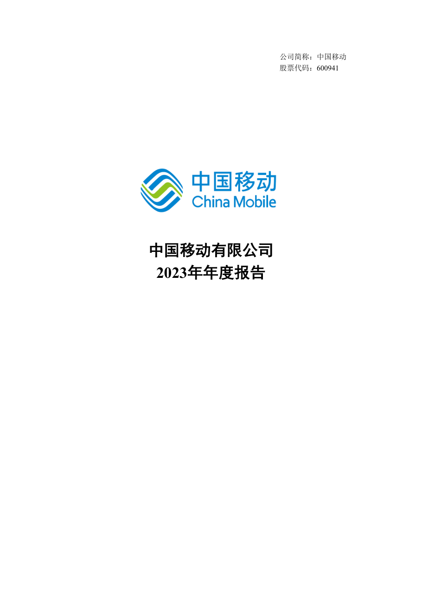
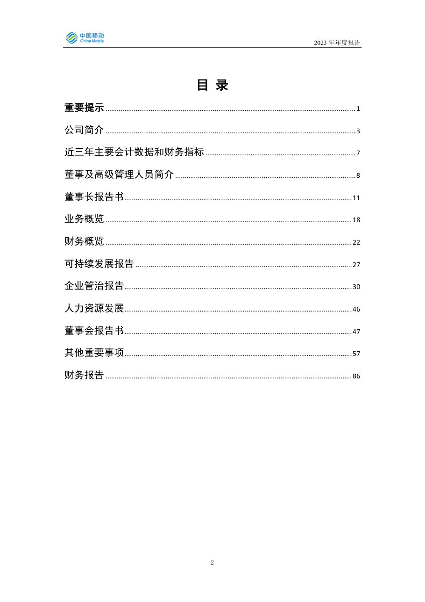
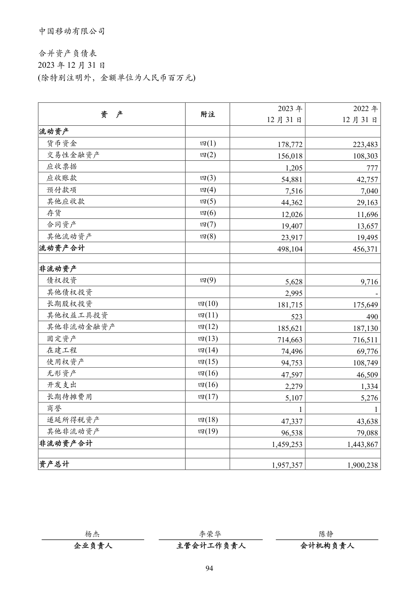
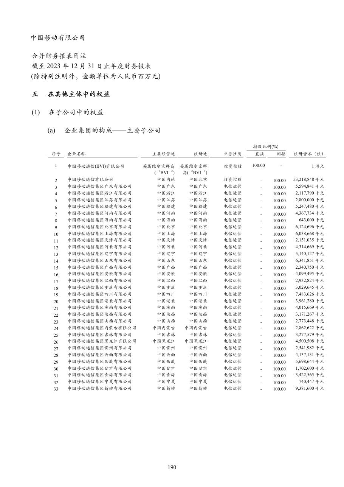
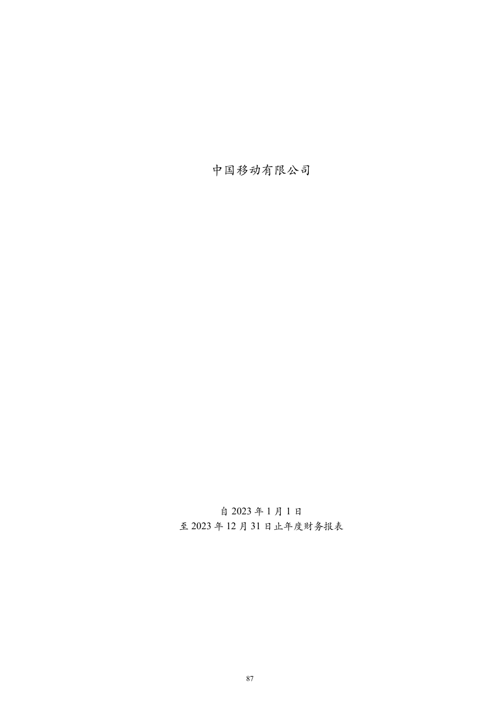

# 600941_2023 页面解析人工抽查

- 样本数：6
- 当前状态：待人工确认

## 验收清单

- [ ] 页面图像与提取文本属于同一PDF物理页
- [ ] 公司、报告年度和报告类型正确
- [ ] 目录章节与页码关系未明显错乱
- [ ] 正文阅读顺序基本正确且无大面积乱码
- [ ] 财务表格的项目、单位和关键数字可对应
- [ ] 异常页属于合理短页/封面/签署页，而非正文漏提取

## cover - PDF第1页

- 抽查原因：PDF封面与报告身份核验
- 印刷页码：None
- 章节：unknown
- 字符数：30
- 质量标记：['short_page']



### 提取文本

```text
公司简称：中国移动
股票代码：600941
2023年年度报告
0
```

## table_of_contents - PDF第3页

- 抽查原因：目录与章节页码核验
- 印刷页码：2
- 章节：unknown
- 字符数：1662
- 质量标记：[]



### 提取文本

```text
目 录
重要提示 ..................................................................................................................................... 1
公司简介 ..................................................................................................................................... 3
近三年主要会计数据和财务指标 ................................................................................ 7
董事及高级管理人员简介 ................................................................................................ 8
董事长报告书 ......................................................................................................................... 11
业务概览 ................................................................................................................................... 18
财务概览 ................................................................................................................................... 22
可持续发展报告 ................................................................................................................... 27
企业管治报告 ......................................................................................................................... 30
人力资源发展 ......................................................................................................................... 46
董事会报告书 ......................................................................................................................... 47
其他重要事项 ......................................................................................................................... 57
财务报告 ................................................................................................................................... 86
2
```

## financial_table - PDF第95页

- 抽查原因：财务表格行列、数字和单位核验
- 印刷页码：94
- 章节：六、注册会计师对财务报表审计的责任 (续)
- 字符数：630
- 质量标记：[]



### 提取文本

```text
合并资产负债表
2023 年12 月31 日
(除特别注明外，金额单位为人民币百万元)
2023 年 2022 年
资 产 附注
12 月31 日 12 月31 日
流动资产
货币资金 四(1) 178,772 223,483
交易性金融资产 四(2) 156,018 108,303
应收票据 1,205 777
应收账款 四(3) 54,881 42,757
预付款项 四(4) 7,516 7,040
其他应收款 四(5) 44,362 29,163
存货 四(6) 12,026 11,696
合同资产 四(7) 19,407 13,657
其他流动资产 四(8) 23,917 19,495
流动资产合计 498,104 456,371
非流动资产
债权投资 四(9) 5,628 9,716
其他债权投资 2,995 -
长期股权投资 四(10) 181,715 175,649
其他权益工具投资 四(11) 523 490
其他非流动金融资产 四(12) 185,621 187,130
固定资产 四(13) 714,663 716,511
在建工程 四(14) 74,496 69,776
使用权资产 四(15) 94,753 108,749
无形资产 四(16) 47,597 46,509
开发支出 四(16) 2,279 1,334
长期待摊费用 四(17) 5,107 5,276
商誉 1 1
递延所得税资产 四(18) 47,337 43,638
其他非流动资产 四(19) 96,538 79,088
非流动资产合计 1,459,253 1,443,867
资产总计 1,957,357 1,900,238
杨杰 李荣华 陈静
企业负责人 主管会计工作负责人 会计机构负责人
94
```

## body_text - PDF第191页

- 抽查原因：普通正文顺序与可读性核验
- 印刷页码：190
- 章节：一、综合收益总额 - - 1,259 - - 125,459 135 126,853
- 字符数：1618
- 质量标记：[]



### 提取文本

```text
(除特别注明外，金额单位为人民币百万元)
五 在其他主体中的权益
(1) 在子公司中的权益
(a) 企业集团的构成——主要子公司
持股比例(%)
序号 企业名称 主要经营地 注册地 业务性质 直接 间接 注册资本（注）
1 中国移动通信(BVI)有限公司 英属维尔京群岛 英属维尔京群 投资控股 100.00 - 1 港元
(“BVI“) 岛(“BVI“)
2 中国移动通信有限公司 中国内地 中国北京 投资控股 - 100.00 53,218,848 千元
3 中国移动通信集团广东有限公司 中国广东 中国广东 电信运营 - 100.00 5,594,841 千元
4 中国移动通信集团浙江有限公司 中国浙江 中国浙江 电信运营 - 100.00 2,117,790 千元
5 中国移动通信集团江苏有限公司 中国江苏 中国江苏 电信运营 - 100.00 2,800,000 千元
6 中国移动通信集团福建有限公司 中国福建 中国福建 电信运营 - 100.00 5,247,480 千元
7 中国移动通信集团河南有限公司 中国河南 中国河南 电信运营 - 100.00 4,367,734 千元
8 中国移动通信集团海南有限公司 中国海南 中国海南 电信运营 - 100.00 643,000 千元
9 中国移动通信集团北京有限公司 中国北京 中国北京 电信运营 - 100.00 6,124,696 千元
10 中国移动通信集团上海有限公司 中国上海 中国上海 电信运营 - 100.00 6,038,668 千元
11 中国移动通信集团天津有限公司 中国天津 中国天津 电信运营 - 100.00 2,151,035 千元
12 中国移动通信集团河北有限公司 中国河北 中国河北 电信运营 - 100.00 4,314,669 千元
13 中国移动通信集团辽宁有限公司 中国辽宁 中国辽宁 电信运营 - 100.00 5,140,127 千元
14 中国移动通信集团山东有限公司 中国山东 中国山东 电信运营 - 100.00 6,341,851 千元
15 中国移动通信集团广西有限公司 中国广西 中国广西 电信运营 - 100.00 2,340,750 千元
16 中国移动通信集团安徽有限公司 中国安徽 中国安徽 电信运营 - 100.00 4,099,495 千元
17 中国移动通信集团江西有限公司 中国江西 中国江西 电信运营 - 100.00 2,932,824 千元
18 中国移动通信集团重庆有限公司 中国重庆 中国重庆 电信运营 - 100.00 3,029,645 千元
19 中国移动通信集团四川有限公司 中国四川 中国四川 电信运营 - 100.00 7,483,626 千元
20 中国移动通信集团湖北有限公司 中国湖北 中国湖北 电信运营 - 100.00 3,961,280 千元
21 中国移动通信集团湖南有限公司 中国湖南 中国湖南 电信运营 - 100.00 4,015,669 千元
22 中国移动通信集团陕西有限公司 中国陕西 中国陕西 电信运营 - 100.00 3,171,267 千元
23 中国移动通信集团山西有限公司 中国山西 中国山西 电信运营 - 100.00 2,773,448 千元
24 中国移动通信集团内蒙古有限公司 中国内蒙古 中国内蒙古 电信运营 - 100.00 2,862,622 千元
25 中国移动通信集团吉林有限公司 中国吉林 中国吉林 电信运营 - 100.00 3,277,579 千元
26 中国移动通信集团黑龙江有限公司 中国黑龙江 中国黑龙江 电信运营 - 100.00 4,500,508 千元
27 中国移动通信集团贵州有限公司 中国贵州 中国贵州 电信运营 - 100.00 2,541,982 千元
28 中国移动通信集团云南有限公司 中国云南 中国云南 电信运营 - 100.00 4,137,131 千元
29 中国移动通信集团西藏有限公司 中国西藏 中国西藏 电信运营 - 100.00 5,698,644 千元
30 中国移动通信集团甘肃有限公司 中国甘肃 中国甘肃 电信运营 - 100.00 1,702,600 千元
31 中国移动通信集团青海有限公司 中国青海 中国青海 电信运营 - 100.00 3,422,565 千元
32 中国移动通信集团宁夏有限公司 中国宁夏 中国宁夏 电信运营 - 100.00 740,447 千元
33 中国移动通信集团新疆有限公司 中国新疆 中国新疆 电信运营 - 100.00 9,381,600 千元
190
```

## flagged_page - PDF第87页

- 抽查原因：异常页复核：short_page
- 印刷页码：86
- 章节：unknown
- 字符数：6
- 质量标记：['short_page']


### 提取文本

```text
财务报告
86
```

## flagged_page - PDF第88页

- 抽查原因：异常页复核：short_page
- 印刷页码：87
- 章节：unknown
- 字符数：31
- 质量标记：['short_page']



### 提取文本

```text
自2023 年1 月1 日
至2023 年12 月31 日止年度财务报表
87
```
